# SOM-Portal System Manual

Sep 24, 2026 · @Kennoi

---

## 1. Introduction

SOM-Portal (Centralize-SOM) คือ internal service operations dashboard ของทีม Ascend/TrueMoney ใช้รวมศูนย์งาน operations ที่ทีมต้องทำซ้ำๆ ทุกวันไว้ในที่เดียว ได้แก่ การโพสต์ incident, สร้าง Jira ticket, ตรวจสอบ Jenkins pipeline, ดู performance ของ service, monitor batch jobs, และจัดการทีม

### ใครใช้บ้าง

ระบบรองรับ **หลายทีม (multi-team)** แต่ละทีมมี data แยกกันสมบูรณ์ ไม่ปนกัน

| Role | สิทธิ์ | ตัวอย่างผู้ใช้ |
| --- | --- | --- |
| `sm_user` | ดูและใช้งานฟีเจอร์ทั่วไป | ทุกคนในทีม |
| `sm_lead` | บวกสิทธิ์จัดการบาง section | Lead / senior |
| `sm_admin` | จัดการทุกอย่างรวมถึง Admin Panel | Admin |
| `super_admin` | ข้ามทีม + super-admin pages | Platform owner |
| `dev_user` | read-only access เฉพาะ service monitoring | Dev team |

### Tech Stack

- **Backend:** PHP (procedural, ไม่มี framework) — ทุก API อยู่ใน `/api/*/index.php`
- **Frontend:** Vanilla JS + HTML — ไม่มี build step, serve ตรงจาก PHP built-in server หรือ Apache/NGINX
- **Storage:** JSON files ใน `/data/` — ไม่มี database
- **Auth:** JWT HS256 signed ด้วย `JWT_SECRET` จาก `.env`
- **External integrations:** Jira (Atlassian Cloud), Jenkins (internal), Grafana/Thanos, OpenSearch, Google Sheets (iframe)

### Multi-Team Architecture

ทุกทีมใช้ codebase เดียวกัน แต่ข้อมูลแยกกันผ่าน JWT `team` claim — เมื่อ user login, token จะมี `team: "sm"` (หรือชื่อทีม) และทุก API call จะอ่าน/เขียนไปยัง `data/<team>/` โดยอัตโนมัติผ่าน helper `teamDataPath()`

### การ Run ระบบ

```bash
cp .env.example .env
# แก้ไข .env: ตั้ง JWT_SECRET, JIRA_EMAIL, JIRA_TOKEN
php -S localhost:8000
```

## 2. Architecture

## 2. Architecture

### Request Flow

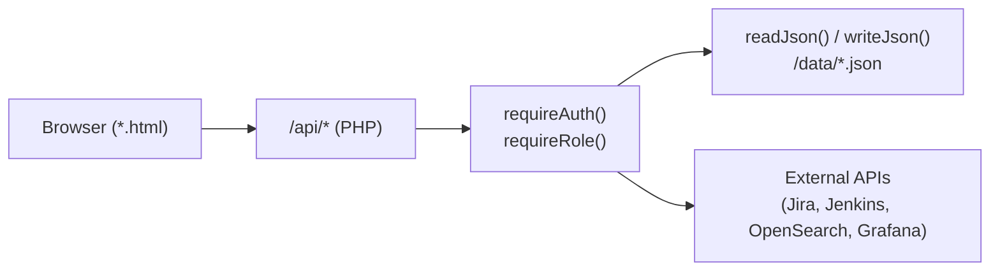

### Multi-Team Data Routing

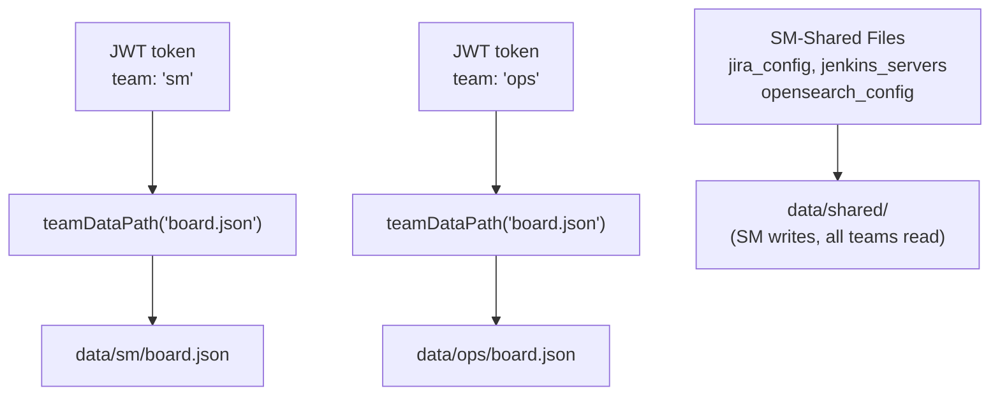

ทุก API endpoint เรียก `teamDataPath()` แทน `DATA_DIR` — team claim จาก JWT คือสิ่งที่ตัดสินว่า data ไปเก็บที่ไหน

### Key Files

| File | หน้าที่ |
| --- | --- |
| `api/helpers.php` | Core library: JWT, auth middleware, JSON I/O พร้อม file lock, rate limiting, activity/security logging, ID generation |
| `api/config.php` | Load `.env`, set constants (`JWT_SECRET`, `DATA_DIR`, `UPLOADS_DIR`), apply CORS/security headers |
| `data/` | ทุก persistent state เป็น JSON files (`users.json`, `board.json`, `templates.json`, ฯลฯ) |
| `assets/js/api.js` | Centralized fetch wrapper ฝั่ง browser — typed namespaces (`API.board`, `API.users`, ฯลฯ) |
| `assets/js/auth.js` | จัดการ JWT ใน `localStorage`, redirect เมื่อ 401 |
| `assets/js/layout.js` | Render nav/sidebar + icon system (147 icons) |

### โครงสร้างโฟลเดอร์

```
SOM-Portal/
├── api/                  # PHP API endpoints (แต่ละ module = 1 folder)
│   ├── helpers.php       # Core library (JWT, auth, I/O, logging)
│   ├── config.php        # Constants + CORS headers
│   └── auth/, board/, jira/, jenkins-proxy/, ...  (100+ modules)
├── assets/
│   ├── js/               # api.js, auth.js, layout.js, utils.js, theme.js, ...
│   └── css/              # ui-themes.css + page CSS
├── data/               # JSON storage (per-team subfolder per multi-team)
│   ├── sm/               # team "sm" data (board.json, users.json, ...)
│   └── shared/           # SM-owned shared data (everyone can read)
├── admin/              # Admin-only HTML pages
└── *.html              # User-facing pages
```

### พื้นฐาน: `readJson` / `writeJson`

ห้ามเขียนไฟล์โดยตรง — ใช้เพียง helpers `readJson()` / `writeJson()` เท่านั้น เพราะ handle `flock` + multi-team routing ผ่าน `teamDataPath()` อัตโนมัติ

```php
// ถูก: ใช้ teamDataPath เสมอ
$data = readJson(teamDataPath('board.json'));

// ผิด: ข้อมูลไหลข้ามทีม
$data = readJson(DATA_DIR . 'board.json'); // อ่านผิด team!
```

### SM-Shared Files

บางไฟล์ SM เป็นเจ้าของ แต่ทุกทีมอ่านได้ ใช้ผ่าน `smSharedFiles()` + `requireSmForShared()` — ตัวอย่าง ได้แก่ jenkins\_servers, jira\_config, opensearch\_config

## 3. Authentication & User Management

## 3. Authentication & User Management

### Login Flow

### Full Auth & Request Lifecycle

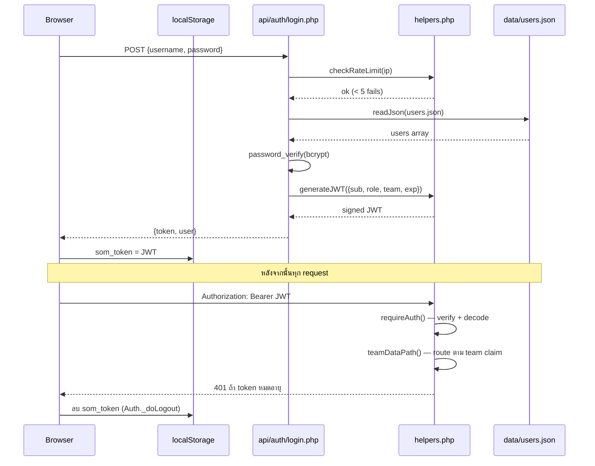

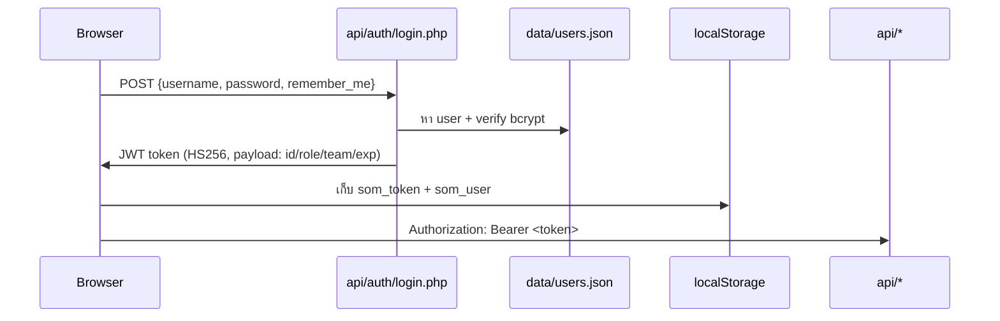

### Roles & Permissions

| Role | สิทธิ์สำคัญ |
| --- | --- |
| `sm_user` | อ่าน board, สร้าง post, ใช้ Jira templates, ดู monitoring |
| `sm_lead` | บวก pin post, อนุมัติ leave, จัดการ knowledge base |
| `sm_admin` | Admin Panel ทั้งหมด (ยกเว้น super-admin pages) |
| `super_admin` | ทุกสิทธิ์ + ดูผ่าน admin ได้ทุกทีม, ข้าม maintenance mode |
| `super_viewer` | Read-only ดูได้ทุกทีม แต่เขียนไม่ได้ |
| `dev_sm` | ทำงานแทน admin สำหรับทีม dev |
| `dev_user` | Read-only service monitoring (service-performance, restart-monitor) |

### Token Structure

```json
{
  "sub": "user-uuid",
  "role": "sm_admin",
  "team": "sm",
  "exp": 1234567890,
  "is_genz": false
}
```

Token หมดอายุ 8 ชั่วโมง (default) / 30 วัน (ถ้าเลือก remember me) — configure ได้ผ่าน Admin > System Settings

### User Management (`api/users/`)

- **CRUD:** `GET /api/users/` (admin only), `POST` สร้าง, `PUT /{id}` แก้, `DELETE /{id}` ลบ
- **ฟีเจอร์พิเศษ:** `is_genz` flag, `dev_subteam` field (29 sub-teams สำหรับ dev team)
- **Password:** bcrypt ผ่าน `password_hash()` — normalize `$2b$` → `$2y$` สำหรับ legacy Python hashes
- **Profile:** `api/auth/profile.php` — แก้ชื่อ/avatar; `api/auth/change-password.php` — เปลี่ยนรหัสผ่านเอง
- **Activity log:** `api/auth/my-activity.php` — user ดูประวัติการทำงานของตัวเอง

### Login Rate Limiting

5 ครั้ง → lock 15 นาที (file-based, `data/rate_limit.json`) — configure ได้ผ่าน Admin > System Settings

## 4. Service Board

## 4. Service Board

Board คือหัวใจหลักของ SOM-Portal — ใช้โพสต์ incident/issue และติดตามสถานะแบบ real-time

### Statuses

### Post Status State Machine

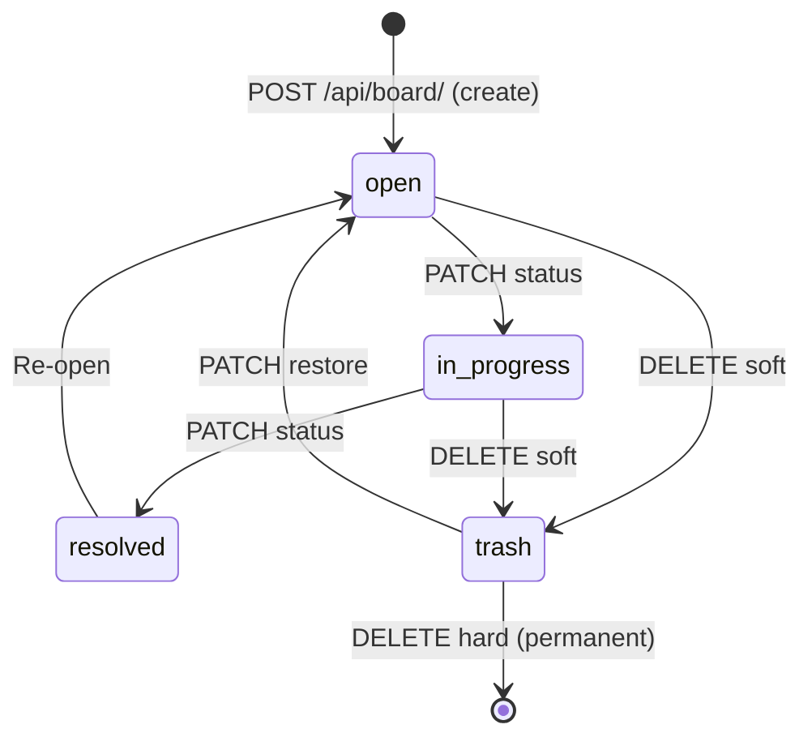

| Status | ความหมาย |
| --- | --- |
| `open` | เพิ่งเปิด / กำลังดูอยู่ |
| `in_progress` | กำลังแก้ไข |
| `resolved` | แก้ไขแล้ว |

### Features

- **Post CRUD:** สร้าง/แก้/ลบ (soft-delete — เข้า trash ก่อน, restore ได้)
- **Comments:** `api/board-comments/` — แสดงความเห็นใต้ post
- **Pin:** sm\_lead/admin สามารถ pin post ไว้ด้านบน
- **Stars/Bookmarks:** แต่ละ user bookmark post ส่วนตัว (`api/stars/`)
- **Categories/Tabs:** configure ได้ผ่าน `api/board-config/` — แต่ละทีมมี tab และ service type taxonomy เป็นของตัวเอง
- **Trash & Restore:** Admin > Board (admin/board.html) — ดู soft-deleted posts, restore หรือลบถาวร
- **Full-text Search:** `api/search/` — ค้นใน board + templates + links พร้อมกัน

### API Endpoints (`api/board/`)

| Method | Path | การใช้งาน |
| --- | --- | --- |
| GET | `/api/board/` | ดึง posts (กรองตาม tab/status/category) |
| POST | `/api/board/` | สร้าง post ใหม่ |
| PUT | `/api/board/?id={id}` | แก้ไข post |
| DELETE | `/api/board/?id={id}` | Soft-delete (soft) / ลบถาวร (hard) |
| PATCH | `/api/board/?id={id}&action=restore` | Restore จาก trash |
| PATCH | `/api/board/?id={id}&action=pin` | Toggle pin |

### หน้า board.html

### Board Post Creation & Comment Flow

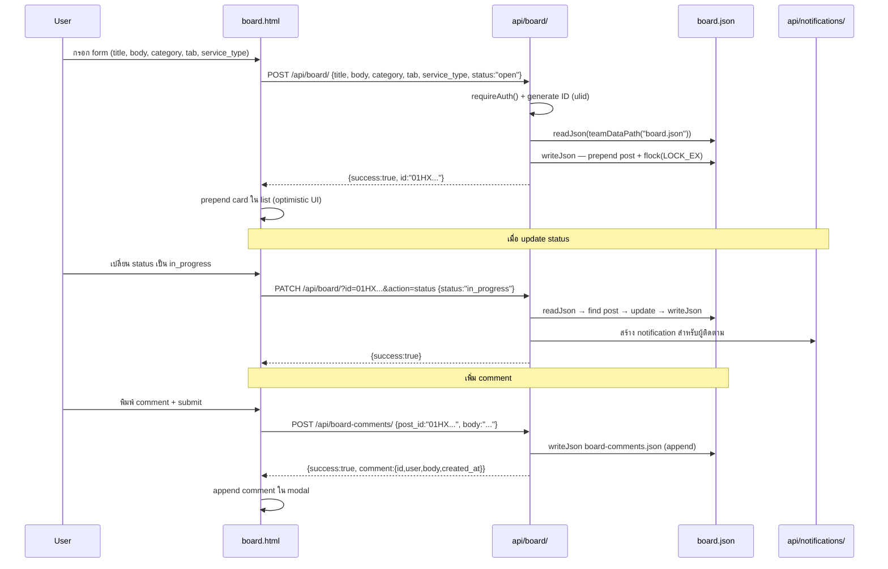

- แสดง posts แยก tab ตาม category
- คลิก post เปิด modal แสดงรายละเอียด + comments + ปุ่มสร้าง Jira ticket จาก post นั้นในคลิกเดียว
- Admin เห็น admin/board.html สำหรับจัดการ trash และ board config

## 5. Jira Integration

## 5. Jira Integration

### Jira Issue Creation Flow

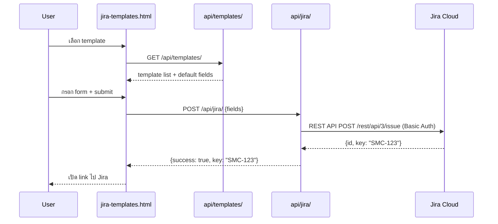

### Jira Custom Field Mapping Flow

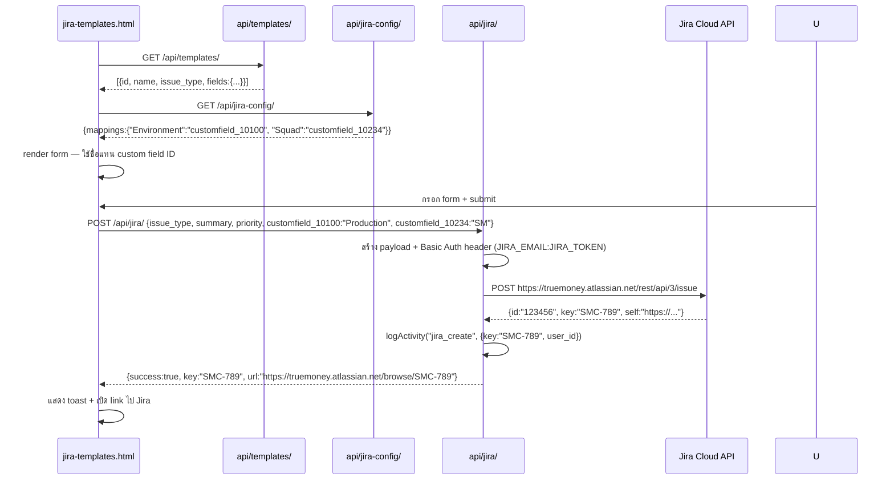

เชื่อมต่อ Jira Cloud (`truemoney.atlassian.net`) ผ่าน Basic Auth (email + API token) จาก `.env`

### Components

| Module | หน้าที่ |
| --- | --- |
| `api/jira/` | สร้าง Jira issue + ดึง issue types / custom fields |
| `api/jira-config/` | จัดการ custom field mappings (`data/jira_config.json`) |
| `api/templates/` | Jira issue templates พร้อม pre-filled defaults |
| `api/jira-requests/` | ส่ง Jira requests แบบเข้าคิว (inbox) |
| `jira-templates.html` | หน้าเลือก template + form กรอกข้อมูล |
| `admin/templates.html` | Admin จัดการ templates |
| `admin/jira-config.html` | Admin ตั้งค่า custom field mapping |

### Templates

Template คือโครงสร้างที่บันทึกไว้ล่วงหน้าว่า Jira issue นี้ต้องกรอกอะไรบ้าง (ไม่ต้องจำค่า custom field ID)

```json
{
  "name": "Production Incident",
  "issue_type": "Bug",
  "fields": {
    "summary": "[INCIDENT] {service_name}",
    "priority": "High",
    "customfield_10100": "Production"
  }
}
```

### การ Map Custom Fields

Jira custom field ID (เช่น `customfield_10100`) map ไปเป็นชื่อที่อ่านได้ใน `data/jira_config.json` — admin แก้ไขได้ที่ `admin/jira-config.html`

### Hardcoded Config

- `JIRA_BASE_URL` = `https://truemoney.atlassian.net` (hardcoded ใน `api/config.php`)
- `JIRA_PROJECT_KEY` = `SMC` (hardcoded)

### Inbox / Jira Requests

`inbox.html` + `api/jira-requests/` — user ส่ง request เข้าคิว, sm\_lead อนุมัติแล้วสร้าง Jira ticket อัตโนมัติ

## 6. Jenkins Integration

## 6. Jenkins Integration

### Jenkins Proxy Flow

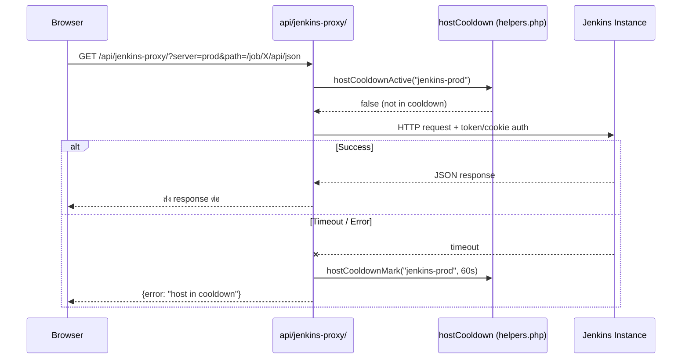

SOM-Portal เชื่อมต่อ Jenkins หลาย instance (internal) ผ่าน proxy layer — แต่ละ server มี credential แยกกัน

### Components

| Module | หน้าที่ |
| --- | --- |
| `api/jenkins-servers/` | CRUD Jenkins server configs (`data/jenkins_servers.json`) |
| `api/jenkins-proxy/` | Proxy requests ไป Jenkins (per-server token/cookie auth) |
| `api/jenkins-build/` | ดู build history + trigger build |
| `api/jenkins-portal/` | Jenkins portal data (job listing, pipeline status) |
| `api/so-jenkins/` | SO team Jenkins integration |
| `api/health/` | Health check Jira & Jenkins (รวม latency) |
| `jenkins-portal.html` | หน้าดูภาพรวม pipeline health |
| `jenkins-build.html` | ดู build history + trigger เสริม deploy |
| `so-jenkins.html` | Jenkins portal สำหรับ SO team |
| `admin/jenkins-servers.html` | Admin เพิ่ม/แก้/ลบ Jenkins server configs |

### Jenkins Server Config

### Jenkins Build — Trigger & Poll Flow

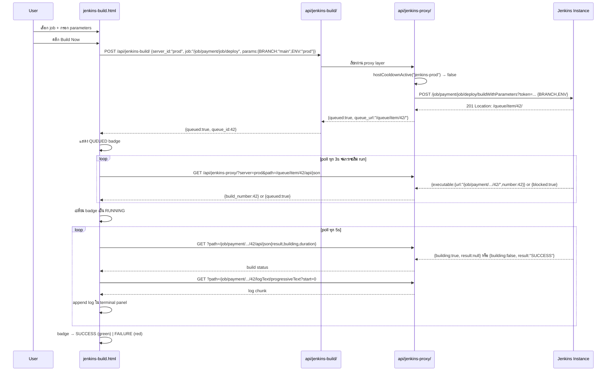

Jenkins server แต่ละตัวเก็บไว้ใน `data/jenkins_servers.json`:

```json
{
  "id": "jenkins-prod",
  "name": "Production Jenkins",
  "url": "https://jenkins.internal.example.com",
  "auth_type": "token",
  "token": "..."
}
```

### Host Cooldown Circuit Breaker

`api/helpers.php` มี `hostCooldownActive()` / `hostCooldownMark()` — ถ้า Jenkins/Jira down, ระบบจะ skip request ไป 60 วินาที แทนที่จะ hang ให้ user รอ (circuit breaker pattern)

### Host Cooldown Circuit Breaker — Detail

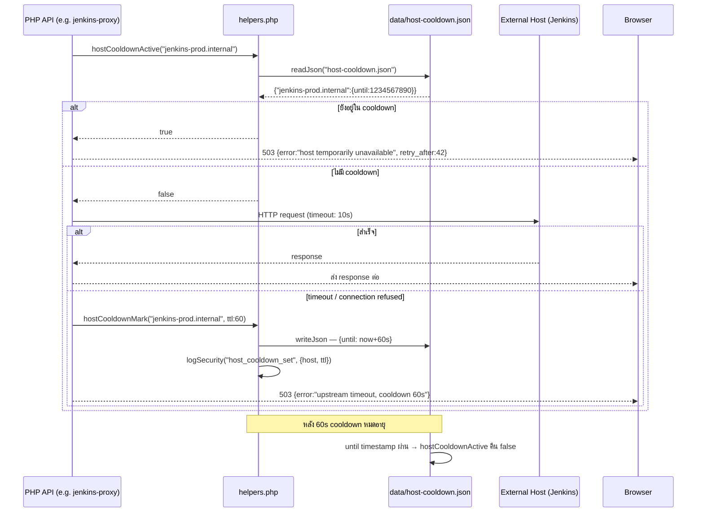

### Health Check

`api/health/` — ping Jira + ทุก Jenkins server พร้อมวัด latency — แสดงผลแบบ real-time บน dashboard

## 7. Monitoring & Observability

## 7. Monitoring & Observability

### Monitoring Data Pipeline

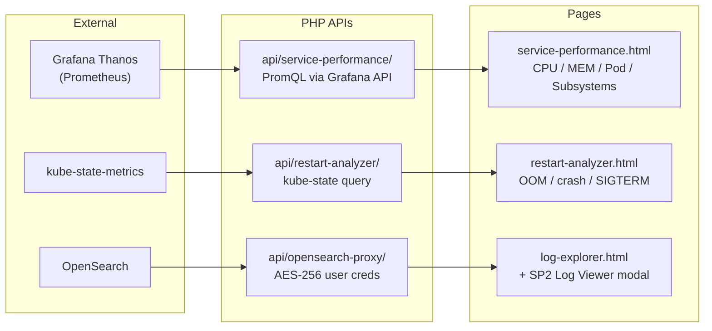

### Service Performance — PromQL Query Chain

```mermaid
sequenceDiagram
    participant F as service-performance.html
    participant S as api/service-performance/
    participant G as Grafana Thanos API
    participant I as service-inventory CSV

    U->>F: พิมพ์ชื่อ service ใน search box
    F->>I: GET /api/service-inventory/ (autocomplete list)
    I-->>F: [{name, runway, team}]
    U->>F: เลือก service + range (1h/6h/24h)

    par โหลด metrics พร้อมกัน
        F->>S: GET /api/service-performance/?service=X&range=1h&metric=cpu
        S->>G: POST /api/datasources/proxy/{uid}/api/v1/query_range
            query=rate(container_cpu_usage_seconds_total{pod=~"X-.*"}[5m])
        G-->>S: {data:{result:[{values:[[ts,val],...]}]}}
        S-->>F: {cpu:[{ts,val}]}
    and
        F->>S: GET ?metric=memory
        S->>G: query=container_memory_working_set_bytes{pod=~"X-.*"}
        G-->>S: {data:{result:[...]}}
        S-->>F: {memory:[{ts,val}]}
    and
        F->>S: GET ?metric=pods
        S->>G: query=kube_pod_status_ready{pod=~"X-.*",condition="true"}
        G-->>S: {data:{result:[...]}}
        S-->>F: {pods: current_count}
    end

    F->>F: render SVG charts (CPU/MEM timeline + pod chip)

    Note over F,S: เมื่อคลิก tab DB Pool
    U->>F: คลิก DB Pool tab
    F->>S: GET /api/service-performance/subsystems.php?service=X&tab=db_pool&range=1h
    S->>G: query=hikaricp_connections_active{application="X"}
    G-->>S: {data:{result:[...]}}
    S-->>F: {active, idle, pending, max}
    F->>F: render DB Pool panel (lazy, โหลดครั้งแรกเท่านั้น)
```

### CSV Drift Comparison Flow

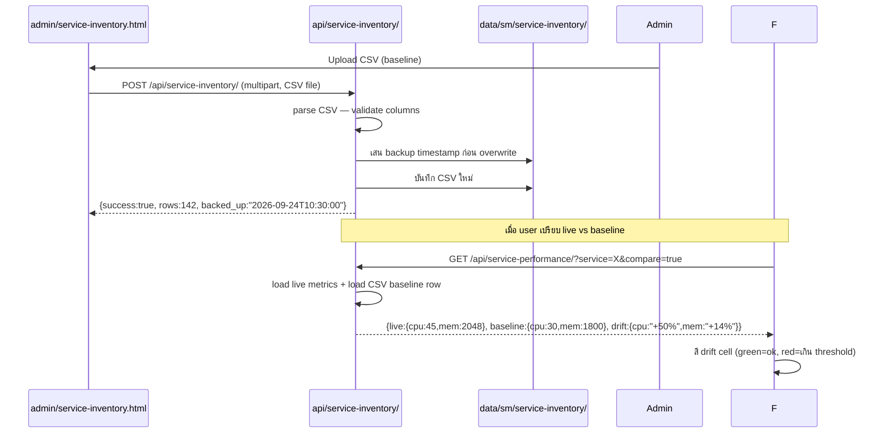

### Service Performance (`service-performance.html`)

เป็น dashboard หลักสำหรับดู health ของ service — ระบบดึงข้อมูล live จาก Grafana Thanos (Prometheus)

**ฟีเจอร์หลัก:**

- Search-first UX — พิมพ์ชื่อ service เพื่อเปิด detail panel
- CPU/Memory/Pod count live ผ่าน PromQL จาก Grafana Thanos
- CSV drift comparison — upload baseline CSV เปรียบกับค่า live
- Subsystem tabs: DB Pool / Tomcat / Runtime / Transaction (lazy fetch)
- Health chips แสดงสตาตัส brief ตาม range ที่เลือก
- Command Center 3-col layout
- Log Viewer modal เชื่อม OpenSearch (inline prompt สำหรับ user creds)
- Admin: CSV upload + สำรอง history ที่ `admin/service-inventory.html`

**API:** `api/service-performance/` + `api/service-performance/subsystems.php`

### Restart Analyzer (`restart-analyzer.html`)

วิเคราะห์สาเหตุ pod restart อัตโนมัติ — OOM / crash / SIGTERM / eviction ผ่าน kube-state-metrics

### Restart Analyzer — kube-state-metrics Query Chain

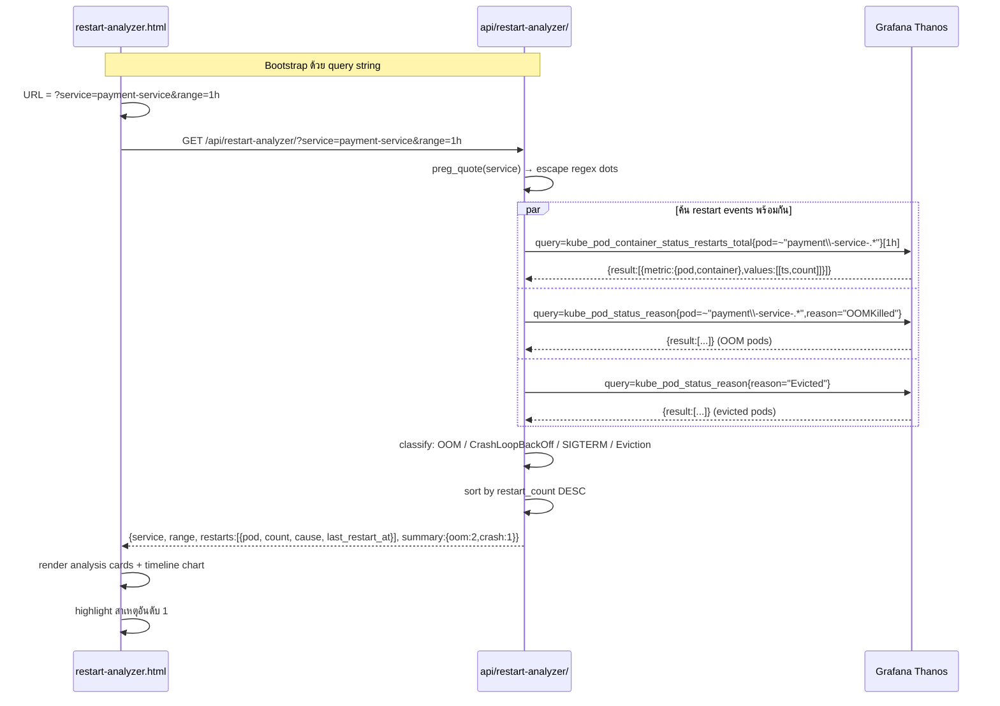

- Bootstrap ด้วย query string: `?service=X&range=1h` รัน analysis ทันทีเมื่อเปิดหน้า
- **API:** `api/restart-analyzer/index.php`

### Restart Monitor (`restart-monitor.html`)

Monitor pod restarts แบบ continuous — webhook-based, admin config ที่ `api/restart-monitor-webhooks/`

### Alert Monitor (`alert-monitor.html`)

ดู Grafana alerts ที่ fire อยู่ในเวลา real-time — config ที่ `admin/alert-monitor-config.html`, ดึงจาก `api/grafana-alerts/`

### Grafana Sources (`begin-grafana.html`)

พอร์ตัล iframe embed ให้เข้าถึง Grafana dashboards ได้อย่างรวดเร็ว — config ที่ `admin/grafana-sources.html`

### Uptime Monitor (`uptime.html`)

ติดตาม uptime ของ endpoint ต่างๆ — `api/uptime/`

### Downstream Health (`api/downstream-health/`)

ตรวจสอบสสุขภาพของ service ที่ระบบพึ่งพา (downstream dependencies)

## 8. MA (Mobile App) Suite

## 8. MA (Mobile App) Suite

### MA Suite Overview Diagram

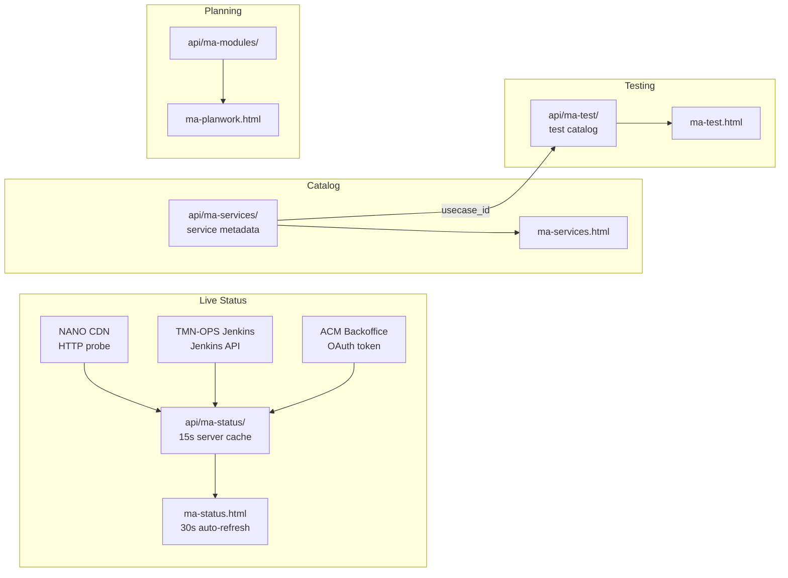

### MA Status — Multi-Source Polling Detail

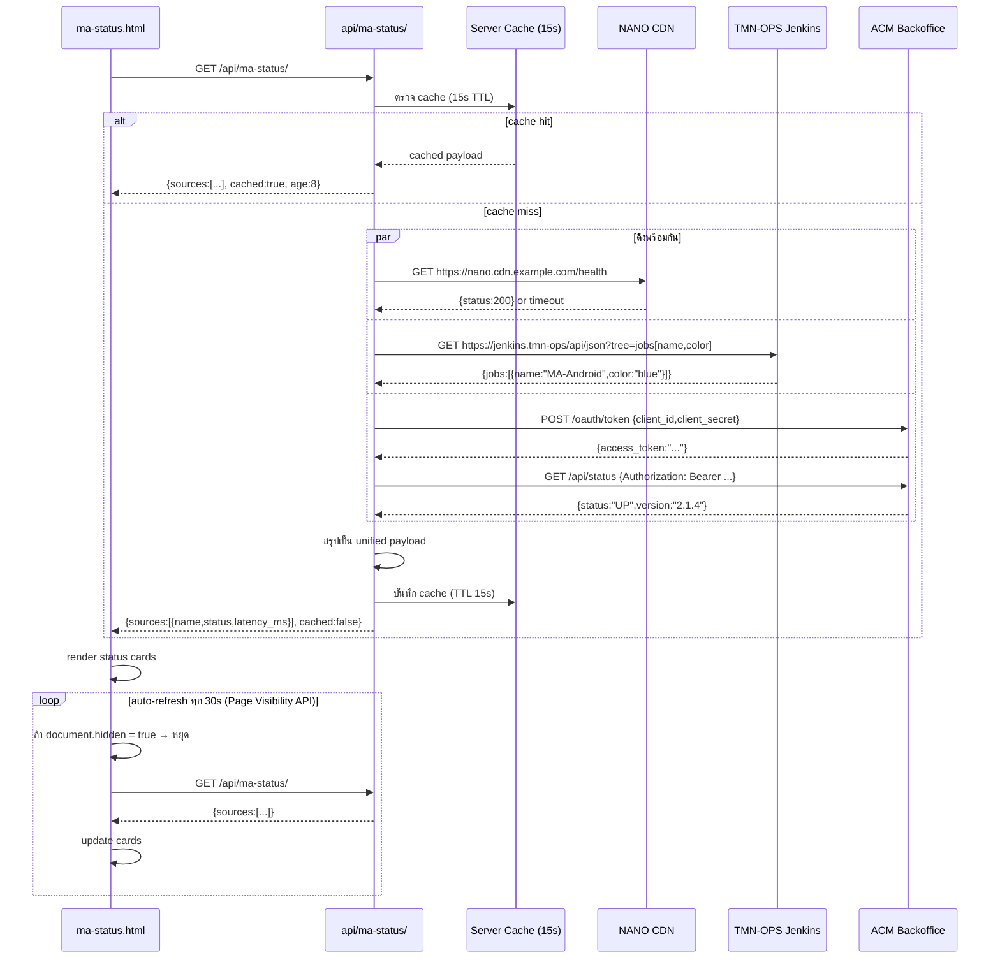

กลุ่ม feature สำหรับดูแล Mobile Application (MA) — ครอบคลุมตั้งแต่ status live ไปจนถึง test planning

### MA Status (`ma-status.html`)

ดู live status ของ MA จากหลาย source พร้อมกัน — auto-refresh ทุก 30 วินาที (หยุดเมื่อ tab ไม่ active)

| Source | วิธีดึงข้อมูล |
| --- | --- |
| NANO CDN | HTTP probe |
| TMN-OPS Jenkins | Jenkins API |
| ACM Backoffice | OAuth token |

- Server-side cache 15 วินาที ที่ `api/ma-status/`
- Admin config: `admin/ma-status.html`

### MA Services (`ma-services.html`)

Catalog ของทุก MA service — เก็บ metadata เช่น ชื่อ, team, endpoint, criticality

- `api/ma-modules/` — module registry
- `api/ma-services/` — service CRUD
- Service มี `usecase_id` เชื่อม MA Test Catalog (field map + batch endpoints)

### MA Test Catalog & Plans

| Page | หน้าที่ |
| --- | --- |
| `ma-test.html` | รัน/ดู test cases แบบ manual/auto |
| `admin/ma-test-catalog.html` | Admin จัดการ test catalog entries |
| `admin/ma-test-plans.html` | Admin สร้าง/แก้ test plan |
| `admin/ma-test-overview.html` | Overview dashboard ทุก plans |

- `api/ma-test/` — test execution + results
- Test catalog entry เชื่อม MA Service ผ่าน `usecase_id`

### MA Plan Work (`ma-planwork.html`)

วางแผนงาน MA แบบ Kanban/timeline — `api/ma-modules/` เป็น backend

### Import MA (`import-ma.html`)

นำเข้าข้อมูล MA จาก external source (bulk import)

## 9. Batch Monitoring

## 9. Batch Monitoring

ติดตามและวิเคราะห์ batch jobs — มีหลาย view สำหรับความต้องการที่ต่างกัน

### Batch Record Submit & Report Flow

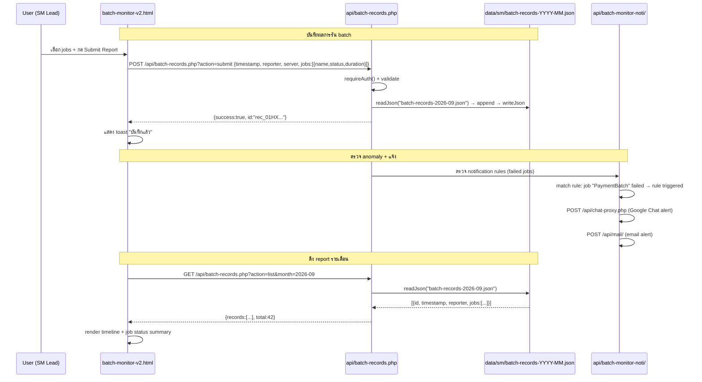

### Pages

| Page | การใช้งาน |
| --- | --- |
| `batch-monitor.html` | ดูสถานะ batch jobs แบบ classic |
| `batch-monitor-v2.html` | Version ใหม่ — UI ดีกว่า, filter เพิ่มเติม |
| `batch-file-search.html` | ค้นหาไฟล์ใน batch index |
| `admin/batch-monitor.html` | Admin config สำหรับ batch monitor |
| `admin/batch-meta.html` | จัดการ metadata ของ batch jobs |
| `admin/batch-file-index.html` | Admin จัดการ file index |
| `admin/batch-monitor-noti.html` | ตั้งค่า notification เมื่อ batch ผิดปกติ |

### APIs

| Module | หน้าที่ |
| --- | --- |
| `api/batch-meta/` | Metadata ของ batch job (schedule, owner, ฯลฯ) |
| `api/batch-file-index/` | Index ไฟล์ output ของ batch |
| `api/batch-deps/` | Dependencies ระหว่าง batch jobs |
| `api/batch-monitor-noti/` | Notification rules เมื่อ job fail/late |
| `api/cutoff-services/` | บันทึก cutoff time ของ services ที่ batch ต้องรักษา |
| `batch-records.php` | Top-level endpoint สำหรับ batch records |
| `test-records.php` | Top-level endpoint สำหรับ test records |

### Batch File Search

`batch-file-search.html` + `api/batch-file-index/` — ค้นไฟล์ output จาก batch run เฉพาะ (เช่น error logs, report files)

## 10. Log Explorer & OpenSearch

## 10. Log Explorer & OpenSearch

### OpenSearch Query Flow

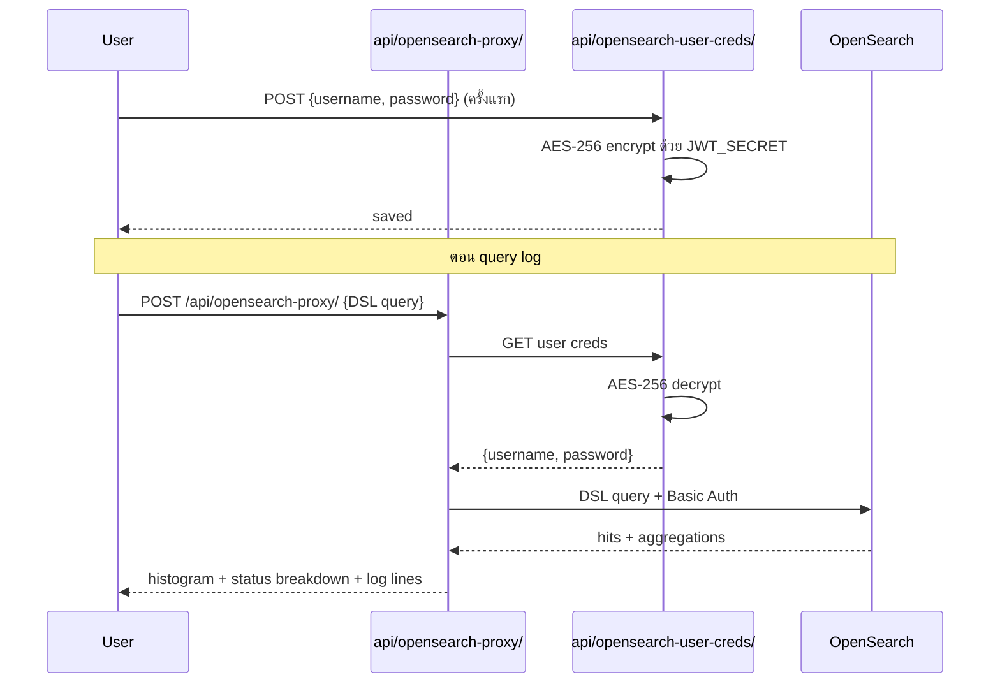

### Log Explorer — Search + Histogram Detail

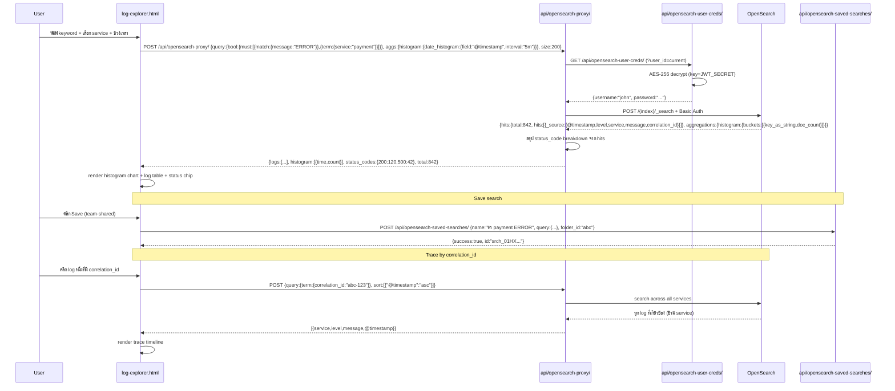

ค้น application logs ผ่าน OpenSearch — ระบบใช้ per-user credentials (AES-256 encrypted) ไม่ใช้ shared admin creds

### Log Explorer (`log-explorer.html`)

หน้าดู log หลัก — 2 tabs:

1. **Search Log** — ค้น full-text, filter ตาม service/level/ช่วงเวลา
2. **Save By SM** — saved searches ที่ SM team share กัน (team-shared)

### Log Viewer Modal (ใน `service-performance.html`)

Modal พิเศษที่เปิดสำหรับ service นั้นๆ — มี correlation ID trace ข้าม services

### Components

| Module | หน้าที่ |
| --- | --- |
| `api/opensearch-proxy/` | Proxy ส่ง DSL query ไป OpenSearch ด้วย user creds |
| `api/opensearch-config/` | Admin config OpenSearch endpoint |
| `api/opensearch-user-creds/` | เก็บ/ให้ user เพิ่ม OpenSearch credentials (AES-256) |
| `api/opensearch-saved-searches/` | CRUD saved searches |
| `api/opensearch-saved-folders/` | จัดกลุ่ม saved searches เป็น folder |
| `admin/opensearch-config.html` | Admin ตั้งค่า OpenSearch endpoint + basic-auth |

### วิธีทำงาน User Credentials

1. User บันทึก OpenSearch username/password ของตัวเอง ผ่าน `api/opensearch-user-creds/`
2. ระบบเขียนเข้าพา AES-256 encrypted
3. ทุก query รับค่า decrypt และส่ง request สิทธิ์แทน user
4. Log Viewer บน service-performance บอกให้ user ใส่ creds inline ถ้ายังไม่เคยบันทึก

### OpenSearch Query

Proxy ใช้ typed DSL — histogram summary + status-code breakdown + correlation ID trace

## 11. Knowledge & Learning

## 11. Knowledge & Learning

กลุ่ม feature เกี่ยวกับการเรียนรู้และเก็บความรู้ภายในทีม

### Knowledge Base (`knowledge-base.html`)

บทความแบบ wiki — จัดเป็น category, ค้นหาได้, เนื้อหาเป็น HTML (rendered)

### Knowledge Base — Search & Dark Mode Content Flow

```mermaid
sequenceDiagram
    participant U as User
    participant F as knowledge-base.html
    participant A as api/knowledge-base/
    participant D as data/sm/knowledge-base.json

    F->>A: GET /api/knowledge-base/?category=incident
    A->>D: readJson(teamDataPath("knowledge-base.json"))
    D-->>A: [{id,title,category,content_html,updated_at}]
    A-->>F: articles list
    F->>F: render cards (category tabs)

    U->>F: คลิก article
    F->>A: GET /api/knowledge-base/?id=kb_01HX...
    A-->>F: {id,title,content_html:"<p style=\"color:#xxx\">...", updated_at}
    F->>F: inject content_html เข้าใน div.kb-body
    F->>F: ui-themes.css override inline styles:
    Note right of F: [style*="color:#f8f9fa"] { color: var(--text) !important }
    Note right of F: แก้ Tailwind pastels ใน content_html เพื่อ dark mode

    U->>F: พิมพ์ใน search box
    F->>A: GET /api/knowledge-base/?q=OOM+crash
    A->>A: full-text search (title + content_html strip tags)
    A-->>F: [{...matched articles}]
    F->>F: highlight คำค้น
```

- `api/knowledge-base/` — CRUD articles
- `admin/knowledge-base.html` — admin เขียน/แก้บทความ
- เนื้อหามีการ override inline style เพื่อรองรับ dark mode ผ่าน CSS attribute selector

### Courses & Exams

### Exam Taking Flow

```mermaid
sequenceDiagram
    participant U as User
    participant F as exam.html
    participant E as api/exams/
    participant D as data/sm/exam-results.json
    participant A as api/achievements/

    F->>E: GET /api/exams/?id=exam_01HX... (ไม่เปิดเฉลย answers)
    E-->>F: {id, title, time_limit:30, questions:[{id,text,choices:[A,B,C,D]}]}
    F->>F: เริ่ม countdown timer (30 นาที)

    loop แต่ละข้อ
        U->>F: เลือกคำตอบ
        F->>F: บันทึก answer[q_id] = "B" (localStorageกัน tab crash)
    end

    alt หมดเวลา หรือ กด Submit
        F->>E: POST /api/exams/submit {exam_id, answers:{q1:"B",q2:"A",...}, time_taken:1420}
        E->>E: ชื่อมตอผลลัพธ์กับเฉลย
        E->>E: คำนวณ score = ถูก/ทั้งหมด * 100
        E->>D: readJson → append result {user_id, exam_id, score, answers, passed: score>=60, submitted_at}
        E->>D: writeJson
        E->>A: อัปเดต badge (silver ถ้า score>=85)
        E-->>F: {score:88, passed:true, correct:22, total:25, badge:"silver"}
        F->>F: แสดงหน้าสรุป: score + badge + เฉลยอธิบาย
    end
```

| Page | หน้าที่ |
| --- | --- |
| `learn.html` | หน้า hub รวมทุกคอร์ส |
| `learn-course.html` | ดูเนื้อหา course พร้อม progress tracking |
| `learn-phase.html` | เนื้อหาแบ่งตาม phase |
| `learn-reports.html` | Report ใครเรียนอะไรกี่ % |
| `exam.html` | สอบ — รับคำถาม + เก็บคะแนน |
| `exam-reports.html` | Report ผลสอบรายคน |
| `admin/courses.html` | Admin สร้าง/แก้ course content |
| `admin/exams.html` | Admin สร้าง/แก้เนื้อหาเพื่อสอบ |

- `api/courses/` + `api/exams/` — CRUD + results
- อนาคต: SM courses หมาย `shared: true` ทุกทีมอ่านได้ (deferred feature)

### Ops Runbook (`ops-runbook.html`)

คู่มือการแก้ปัญหา — step-by-step runbook สำหรับปัญหาที่เกิดบ่อย

- `api/ops-runbook/` — CRUD runbook entries
- `admin/ops-runbook.html` — admin จัดการ runbooks

### Documentation (`documentation.html`)

เอกสารทั่วไปของ SOM-Portal — how-to และ reference docs

### GenZ Notes KB (`genz-notes.html`)

KB เลียนแบบ Obsidian — 3-panel layout, force-directed knowledge graph, click node เพื่อ filter/navigate — เห็นได้เฉพาะ GenZ + SM team

- `api/genz-notes/` — CRUD notes

## 12. Communications

## 12. Communications

กลุ่ม feature เกี่ยวกับการแจ้งเตือนและสื่อสารภายในระบบ

### Email Notifications

### Email Send Flow (SMTP via PHPMailer)

```mermaid
sequenceDiagram
    participant U as User / System
    participant F as send-email.html / trigger
    participant M as api/mail/
    participant MC as api/mail-config/
    participant SMTP as SMTP Server
    participant ML as data/sm/mail-logs.json

    F->>M: POST /api/mail/ {to:["user@example.com"], subject:"[INC] ...", body:"...", template_id?:"tmpl_01"}
    M->>MC: readJson(smSharedPath("mail-config.json"))
    MC-->>M: {host:"smtp.example.com", port:587, username, password, from_name:"SOM Portal"}

    alt มี template_id
        M->>M: readJson("email-templates.json") → inject {header_html, footer_html, logo_url}
        M->>M: wrap body ด้วย template
    end

    M->>M: PHPMailer::isSMTP(), setFrom(), addAddress()
    M->>SMTP: EHLO → STARTTLS → AUTH LOGIN → MAIL FROM → DATA

    alt ส่งสำเร็จ
        SMTP-->>M: 250 OK
        M->>ML: logEntry {to, subject, status:"sent", sent_at}
        M-->>F: {success:true, message_id:"<abc@smtp>"}
    else SMTP error
        SMTP-->>M: 550 / timeout
        M->>ML: logEntry {to, subject, status:"failed", error:"..."}
        M-->>F: {success:false, error:"SMTP connection failed"}
    end
```

| Module | หน้าที่ |
| --- | --- |
| `api/mail/` | ส่ง email (SMTP via PHPMailer) |
| `api/mail-config/` | เก็บการตั้งค่า SMTP |
| `api/email-noti/` | Email notification templates + triggers |
| `api/email-templates/` | Global email templates (header/footer/logo) |
| `api/fh-email-config/` | Config email สำหรับ FH team |
| `send-email.html` | User ส่ง email แบบ manual |
| `admin/email-noti.html` | Admin จัดการ email notification rules |
| `admin/mail-config.html` | Admin ตั้งค่า SMTP |
| `admin/mail-logs.html` | Admin ดู email send history |

### SMS Gateway

| Module | หน้าที่ |
| --- | --- |
| `api/sms-gateway/` | ส่ง SMS ผ่าน gateway |
| `sms-gateway-switches.html` | เปิด/ปิด SMS routes |
| `admin/sms-gateway-config.html` | Admin ตั้งค่า SMS gateway |

### In-App Notifications

- `api/notifications/` — CRUD notifications ภายในแอพ (bell icon)
- `api/scheduled-noti/` — Scheduled notification jobs
- `admin/scheduled-noti.html` — Admin ตั้ง schedule การแจ้ง
- `api/inbox/` — กล่องข้อความเข้า (inbox.html เชื่อมกับ Jira request workflow)

### Scheduled Notification Flow

```mermaid
sequenceDiagram
    participant Admin
    participant F as admin/scheduled-noti.html
    participant SN as api/scheduled-noti/
    participant D as data/sm/scheduled-noti.json
    participant CL as Client (Browser Poll)
    participant CH as api/chat-proxy.php
    participant M as api/mail/

    Admin->>F: ตั้ง notification: cron="0 9 * * 1" (ทุกวันจันทร์ 09:00)
    F->>SN: POST /api/scheduled-noti/ {name, cron, channels:["chat","email"], message:"..."}
    SN->>D: writeJson (append rule)
    SN-->>F: {success:true, id:"noti_01HX..."}

    Note over CL,CH: เมื่อถึงเวลา
    CL->>SN: GET /api/scheduled-noti/?action=check (poll ทุกนาทีจาก noti-scheduler.js)
    SN->>D: readJson → loop rules
    SN->>SN: ตรวจ cron expression vs now (Asia/Bangkok)
    SN->>SN: ถ้า rule ถึงเวลา + ยังไม่ได้ fire ใน 60s นี้

    par ส่งพร้อมกัน
        SN->>CH: POST /chat-proxy.php {webhook:"...", message:"[Reminder] ..."}
    and
        SN->>M: POST /api/mail/ {to:[...], subject:"[Reminder]", body:"..."}
    end
    SN->>D: update last_fired_at
    SN-->>CL: {fired:["noti_01HX..."]}
```

### Announcements

`api/announcements/` + `admin/announcements.html` — banner ประกาศถึงผู้ใช้ทุกคนเมื่อเข้าระบบ

### n8n OnCall

`admin/n8n-oncall-config.html` — เชื่อม n8n workflow สำหรับ on-call automation (auto-notify, escalation)

## 13. Team Features

## 13. Team Features

### My Team (`my-team.html`)

หน้าแสดงสมาชิกทีม — profile cards, role, contact — `api/my-team/`

### About SOM (`about-som.html`)

Org chart + landing page เปิดสาธารณะ (all roles) — edit ได้ที่ `admin/about-page.html`, data อยู่ใน `data/sm/about-page.json`

### GenZ Hub & Notes

| Page | หน้าที่ | ใครเห็น |
| --- | --- | --- |
| `genz-hub.html` | Perk page + เนื้อหา GenZ | GenZ + SM |
| `genz-notes.html` | Obsidian-style KB + graph | GenZ + SM |
| `admin/genz-team.html` | Toggle `is_genz` flag บน user | Admin |

`is_genz` คือ flag บน `sm_user` (ไม่ใช่ role ใหม่) — เปิด purple/pink `body.is-genz` theme เพิ่มเติม

### Dev Team Hub (`dev-hub.html`)

Hub สำหรับ Dev team (role `dev_user`) — read-only access service-performance + restart-monitor

- Dev team มี `dev_subteam` field (29 sub-teams)
- จัดการผ่าน `admin/users.html?team=dev`
- `api/dev-subteams/` — sub-team registry

### PW Schedule (`pw-schedule.html`)

Monthly calendar ดึงจาก Teamup — fetch mode เริ่มต้น: undocumented `teamup.com/{key}/events` XHR (no token, full JSON); fallback ICS + official API

### PW Schedule — Teamup Fetch Strategy

```mermaid
sequenceDiagram
    participant F as pw-schedule.html
    participant S as api/pw-schedule/
    participant CFG as api/pw-schedule-config/
    participant TU as teamup.com

    F->>CFG: GET /api/pw-schedule-config/
    CFG-->>F: {key:"ks1abc...", mode:"xhr", month:"2026-09"}

    alt mode = xhr (เริ่มต้น default)
        F->>S: GET /api/pw-schedule/?month=2026-09
        S->>TU: GET https://teamup.com/{key}/events?startDate=2026-09-01&endDate=2026-09-30
        Note over S,TU: undocumented XHR endpoint — no token required, full JSON
        TU-->>S: {events:[{id,title,start_dt,end_dt,who:[...]}]}
        S-->>F: {events:[...], source:"xhr"}
    else mode = ics
        S->>TU: GET https://teamup.com/{key}.ics
        TU-->>S: VCALENDAR text
        S->>S: parse ICS → events array
        S-->>F: {events:[...], source:"ics"}
    else mode = api
        S->>TU: GET https://api.teamup.com/{key}/events?api_key=...
        TU-->>S: {events:[...]}
        S-->>F: {events:[...], source:"api"}
    end

    F->>F: render monthly calendar grid
    F->>F: คลิกวัน → แสดง event detail modal
```

- `api/pw-schedule/` + `api/pw-schedule-config/`
- `admin/pw-schedule.html` — config calendar key + display options

### SyncUp (`syncup.html`)

Meeting sync + standup tool — `api/syncup/` + `admin/syncup-config.html`

### Schedule (`schedule.html`)

ตารางนัด + การจัดการงานประจำวัน/สัปดาห์ — `api/schedule/` + `admin/schedule.html`

### Holiday Plans (`holiday-plans.html`)

วางแผนวันหยุดและลาพัก — `api/holiday-plans/` + `admin/holiday-plans.html`

### Leave Approval

`admin/leave-approval.html` — admin/lead อนุมัติคำขอลาพัก

### Weekly Report (`weekly-report.html`)

User ส่ง weekly report — `api/weekly-report/` + `admin/weekly-report.html` (admin ดู summary)

## 14. Quick Tools

## 14. Quick Tools

### Links (`api/links/`)

ปุ่มลัดโลก quick-link จัดเป็น section — SM สามารถ share section บางอัน (section-scoped SM share pattern)

- `admin/links.html` — Admin เพิ่ม/แก้/ลบ links

### Search (`api/search/`)

Full-text search ครอบ board posts + templates + links ใน query เดียว

### Full-Text Search Flow

```mermaid
sequenceDiagram
    participant U as User
    participant F as ทุกหน้า (search bar)
    participant S as api/search/
    participant B as data/sm/board.json
    participant T as data/sm/templates.json
    participant L as data/sm/links.json

    U->>F: พิมพ์ สาม อักขรขึ้นไป (debounce 300ms)
    F->>S: GET /api/search/?q=payment&limit=10
    S->>S: requireAuth()

    par ค้นพร้อมกัน
        S->>B: readJson(teamDataPath("board.json"))
        S->>S: filter: title+body contains "payment" (case-insensitive, not deleted)
    and
        S->>T: readJson(teamDataPath("templates.json"))
        S->>S: filter: name+description contains "payment"
    and
        S->>L: readJson(teamDataPath("links.json"))
        S->>S: filter: label+url contains "payment"
    end

    S->>S: merge + score (title match > body match) + slice limit:10
    S-->>F: {results:[{type:"board",id,title,excerpt,url},{type:"template",...},{type:"link",...}]}
    F->>F: render dropdown พร้อมไอคอน type
    U->>F: คลิกผลลัพธ์ → navigate ไป url
```

### Google Sheets (`sheets.html`)

Embed Google Sheets เป็น iframe — config URL ผ่าน `api/sheets/` + `admin/sheets.html`

### Sidebar Tools (`api/sidebar-tools/`)

Tool/link ด้านข้าง sidebar — admin ปรับได้ผ่าน `admin/tools.html`

### Stars / Bookmarks (`api/stars/`)

Bookmark post ผ่านการกด star — เก็บแยกตาม user (personal, ไม่ share กัน)

### Incident Launcher (`incident-launcher.html`)

Automation สำหรับ SM team — 2 modes:

### Incident Launcher Flow

```mermaid
flowchart TD
    Start(["User กด Launch"]) --> Mode{Mode?}

    Mode -->|Guided| G["Step-by-step checklist\nทำทีละ task"]
    Mode -->|Express| E["Fire all 5 tasks\nพร้อมกัน"]

    G --> T1
    E --> T1
    E --> T2
    E --> T3
    E --> T4
    E --> T5

    T1["Task 1: Board Post\napi/board/"]
    T2["Task 2: Jira Ticket\napi/jira/"]
    T3["Task 3: Google Meet\nสร้าง link"]
    T4["Task 4: Chat\nส่ง webhook"]
    T5["Task 5: Email\napi/mail/"]

    T1 & T2 & T3 & T4 & T5 --> Done(["Incident launched"])
```

### Incident Launcher — Express Mode Detail

```mermaid
sequenceDiagram
    participant U as User
    participant F as incident-launcher.html
    participant IL as api/incident-launcher/
    participant B as api/board/
    participant J as api/jira/
    participant CH as api/chat-proxy.php
    participant M as api/mail/

    U->>F: กรอกชื่อ incident + severity + service
    U->>F: คลิก Express Launch
    F->>IL: POST /api/incident-launcher/ {mode:"express", title, severity, service}

    par Task 1: Board Post
        IL->>B: POST /api/board/ {title:"[INC] ชื่อ", status:"open", tab:"incident"}
        B-->>IL: {id:"01HX...", url:"/board.html#01HX..."}
    and Task 2: Jira Ticket
        IL->>J: POST /api/jira/ {summary:"[INC] ชื่อ", priority:"High", customfield_severity:P1}
        J-->>IL: {key:"SMC-999", url:"https://truemoney.atlassian.net/browse/SMC-999"}
    and Task 3: Google Meet
        IL->>IL: generate Meet URL (https://meet.google.com/xxx-xxx-xxx)
    and Task 4: Google Chat
        IL->>CH: POST /chat-proxy.php {webhook:"...", message:"[INC] ชื่อ | Jira: SMC-999 | Meet: ..."}
        CH-->>IL: {status:200}
    and Task 5: Email
        IL->>M: POST /api/mail/ {to:[team_emails], subject:"[INC] ชื่อ", body:"..."}
        M-->>IL: {sent:true}
    end

    IL-->>F: {tasks:[{name,status,url}]}
    F->>F: แสดงผลทุก task พร้อม link
```

| Mode | การใช้งาน |
| --- | --- |
| Guided | ทำทีละ task พร้อม checklist |
| Express | ปิง 5 task พร้อมกันในคลิกเดียว |

5 Tasks: Board post + Jira ticket + Google Meet + Chat + Email notification

- `api/incident-launcher/` — execute tasks
- `admin/incident-launcher-config.html` — config template แต่ละ task

### Report Center (`report-center.html`)

รวม reports ทุกประเภท — `report.html` สำหรับ specific report

### Analytics (`analytics.html`)

Dashboard วิเคราะห์การใช้งานระบบ — `api/analytics/` + `admin/analytics.html`

### Pipeline Flow (`pipeline-flow.html`)

แสดง pipeline flow diagram — `api/pipeline-flows/`

### Collection Lead Flow (`collection-lead-flow.html`)

Workflow สำหรับ Collection lead team — `api/collection-lead-flow/`

### Onboarding (`onboarding.html`)

สำหรับ user ใหม่ — ทำตามระบบทีละขั้นตอน — `api/onboarding/` + `admin/onboarding.html`

### Presence (`api/presence/`)

User presence tracking (online/offline status ใน UI)

### Presence Tracking Flow

```mermaid
sequenceDiagram
    participant F as ทุกหน้า
    participant P as api/presence/
    participant D as data/sm/presence.json

    Note over F,D: เมื่อเปิดหน้า
    F->>P: POST /api/presence/ {status:"online", page:"board"}
    P->>D: readJson → upsert {user_id, status, page, last_seen:now} → writeJson
    P-->>F: {success:true}

    loop heartbeat ทุก 30s
        F->>P: POST /api/presence/ {status:"online", page:"board"}
        P->>D: update last_seen
    end

    Note over F,D: ดึงรายชื่อ online
    F->>P: GET /api/presence/
    P->>D: readJson → filter last_seen > now-60s
    P-->>F: {online:[{user_id, name, avatar, page}]}
    F->>F: render online dots บน avatar cards

    Note over F,D: เมื่อปิดหน้า (beforeunload)
    F->>P: POST {status:"offline"}
    P->>D: update status + last_seen
```

## 15. Admin Panel

## 15. Admin Panel

ทุกหน้าใน `admin/` ต้อง role `sm_admin` ขึ้นไป — `super_admin` เข้าได้ทุกหน้ารวมถึง super-admin pages

### Maintenance Mode Gate Flow

```mermaid
flowchart TD
    A(["User เปิด URL"]) --> B["maintenance.js: checkMaintenance()"]
    B --> C{"GET /api/maintenance/\n{enabled, message, bypass_roles}"}
    C -->|enabled = false| D["load page ปกติ"]
    C -->|enabled = true| E{"user role?"}
    E -->|super_admin| F["bypass — load pageปกติ"]
    E -->|PAGE_FILES bypass list| G{"current page อยู่ใน list?"}
    G -->|yes| F
    G -->|no| H["redirect maintenance.html"]
    E -->|รอล์อื่น| H
    H --> I["maintenance.html: แสดงสถานะ + ETA"]
```

### Menu Permission Check Flow

```mermaid
sequenceDiagram
    participant F as *.html
    participant L as layout.js
    participant MP as api/menu-permissions/
    participant NG as api/nav-groups/
    participant D as menu-permissions.json

    F->>L: Layout.init()
    L->>L: Auth.getUser() → {role:"sm_user", team:"sm"}
    L->>MP: GET /api/menu-permissions/ (cached in localStorage 5m)
    MP->>D: readJson("menu-permissions.json")
    D-->>MP: {sm_user:["board","jira-templates",...], sm_lead:[...], sm_admin:[...]}
    MP-->>L: permission map
    L->>NG: GET /api/nav-groups/?role=sm_user
    NG-->>L: [{group:"Operations", items:["board","jira-templates"]},{group:"Monitoring",...}]
    L->>L: filter items ตาม role + จัดกลุ่ม
    L->>L: render sidebar nav
    L->>L: Icons.replaceAll() — scan DOM แทน data-icon="NAME"
```

### User & Team Management

| Page | หน้าที่ |
| --- | --- |
| `admin/users.html` | CRUD users, assign roles, toggle `is_genz`, dev team (`?team=dev`) |
| `admin/menu-permissions.html` | กำหนดว่า role ไหนเห็น menu อะไร |
| `admin/nav-groups.html` | จัดกลุ่ม nav items เป็น group |
| `admin/super-team-permissions.html` | สิทธิ์ระดับ team (super-admin only) |
| `admin/genz-team.html` | Toggle GenZ flag บน user |

### System Configuration

| Page | หน้าที่ |
| --- | --- |
| `admin/system-settings.html` | Session timeout, rate limits, feature flags |
| `admin/maintenance.html` | เปิด/ปิด maintenance mode + กำหนด page bypass list |
| `admin/backup.html` | Download backup ของ `data/` |
| `admin/system-monitor.html` | Monitor PHP errors + server stats |

### Board & Content

| Page | หน้าที่ |
| --- | --- |
| `admin/board.html` | จัดการ board (trash, pin, hard-delete) |
| `admin/templates.html` | CRUD Jira templates |
| `admin/jira-config.html` | Custom field mappings |
| `admin/knowledge-base.html` | เขียน/แก้บทความ KB |
| `admin/ops-runbook.html` | จัดการ runbooks |
| `admin/courses.html` | สร้าง/แก้ course content |
| `admin/exams.html` | สร้าง/แก้เนื้อหาสอบ |

### Monitoring Config

| Page | หน้าที่ |
| --- | --- |
| `admin/jenkins-servers.html` | CRUD Jenkins servers |
| `admin/alert-monitor-config.html` | Config Grafana alert sources |
| `admin/grafana-sources.html` | Config Grafana iframe sources |
| `admin/opensearch-config.html` | Config OpenSearch endpoint |
| `admin/ma-config.html` | Config MA integrations |
| `admin/service-inventory.html` | Upload/manage service CSV |
| `admin/service-severity.html` | กำหนดระดับ severity ของ service |

### Logs & Audit

| Page | หน้าที่ |
| --- | --- |
| `admin/logs.html` | ดู activity + security logs |
| `admin/mail-logs.html` | Email send history |
| `admin/analytics.html` | Usage analytics |

### Super-Admin Pages (super\_admin only)

| Page | หน้าที่ |
| --- | --- |
| `admin/super-admin.html` | Platform overview ทุกทีม |
| `admin/super-viewer.html` | ดูหน้า portal ในนามทีมใดก็ได้ |
| `admin/super-team-permissions.html` | กำหนดสิทธิ์ระดับ team |
| `admin/super-email-templates.html` | Global email templates |
| `admin/super-feature-requests.html` | ดู feature requests ทุกทีม |

### Maintenance Mode

เมื่อเปิด maintenance mode, เพจทุกหน้าจะเปลี่ยนเป็น `maintenance.html` — ยกเว้น bypass list (`super_admin` และ pages ที่กำหนดไว้ใน `assets/js/maintenance.js`)

## 16. Frontend Architecture

## 16. Frontend Architecture

### Frontend JS Dependency Map

```mermaid
flowchart TD
    HTML["*.html"] --> Auth["auth.js\nAuth.requireAuth()"]
    HTML --> Layout["layout.js\nLayout.init()"]
    HTML --> Theme["theme.js\nloadTheme()"]
    HTML --> PageJS["page-specific JS"]

    Layout --> Icons["Icons system\n147 Lucide-style icons\nMutationObserver"]
    Layout --> MobileNav["mobile-nav.js"]
    Theme --> Skeletons["skeletons.js\n10 patterns"]
    Theme --> Loading["loading-overlay.js"]

    PageJS --> API["api.js\nAPI.get/post/put...\nAPI.board / API.users / ..."]
    PageJS --> Utils["utils.js\ntoast / modal / format"]

    Auth --> API
    API --> Backend["PHP /api/*"]

    style Backend fill:#2d5a8e,color:#fff
    style API fill:#3a7d44,color:#fff
```

ทุกหน้าต้อง load `auth.js` + `layout.js` + `theme.js` ก่อนเสมอ — ถ้าขาดอันใดอันหนึ่ง จะไม่มี nav / auth guard / theme

### Core JS Files

| File | หน้าที่ |
| --- | --- |
| `assets/js/api.js` | Centralized fetch wrapper — `API.get/post/put/patch/delete/upload` + namespaces (`API.board`, `API.users`, ฯลฯ) — เมื่อ 401 เรียก `Auth._doLogout()` อัตโนมัติ |
| `assets/js/auth.js` | `Auth` object — จัดการ JWT ใน `localStorage` (`som_token`, `som_user`) — `Auth.requireAuth()` redirect unauthenticated |
| `assets/js/layout.js` | Render nav/sidebar + icon system (147 Lucide-style icons) — `Icons.replaceAll()` scan DOM |
| `assets/js/utils.js` | Toast, modal, formatting helpers |
| `assets/js/theme.js` | Load theme + inject skeletons |
| `assets/js/admin-nav.js` | Admin panel navigation (pages under `admin/`) |

### กฎการใช้งาน Frontend

- **ไม่ใช้ `alert/confirm/prompt`** — ใช้ toast + modal จาก `utils.js`
- **Icon:** `<i data-icon="NAME"></i>` — auto-rendered ผ่าน `window.Icons` ใน `layout.js` (MutationObserver จับ dynamic inserts)
- **ไม่ใช้ emoji** — ใช้เฉพาะ SVG icon system
- **CSS vars:** ใช้ `:root` tokens (`--bg-card`, `--border`, `--text`) สำหรับ popovers/toasts ที่ `document.body.appendChild` — scoped vars จะ transparent
- **Grid:** `minmax(0, 1fr)` เสมอ, ไม่ใช้ `1fr` เปล่า
- **Auth + Layout:** ต้อง call เป็น top-level (`Auth.requireAuth()` + `Layout.init()`) ทุกหน้า

### Theme System

4 themes × light/dark = 8 combinations:

| Theme | ลักษณะ |
| --- | --- |
| Glass | โปร่งแส, glassmorphism |
| Enterprise | สะอาด, professional |
| Console | สีเขียว/terminal (always dark) |
| Warm | สีอุ่น, warm tones |

- `assets/js/theme.js` — load + apply theme
- `assets/css/ui-themes.css` — CSS variables + structural overrides per theme
- `settings.html` — user เลือก theme
- **สำคัญ:** ต้องเพิ่ม `!important` structural overrides สำหรับ `.stat-card`/`.badge` ที่มีค่า hardcoded

### Skeleton & Loading

- `assets/js/skeletons.js` — 10 skeleton patterns (auto-loaded via `theme.js`)
- `assets/js/loading-overlay.js` — bots loader animation
- หลักการ: pages ใช้ skeletons สำหรับรอ data — loader auto-hold ถูก revert

### API.js Base URL

`API_BASE` resolve จาก URL path — รองรับ sub-directory hosting โดยอัตโนมัติ — ห้าม fetch `/data/*.json` โดยตรง (blocked by `.htaccess`)

## 17. Security Model

## 17. Security Model

### JWT Authentication

- **Algorithm:** HS256 signed ด้วย `JWT_SECRET` (256-bit hex string ใน `.env`)
- **Payload:** `sub` (user id), `role`, `team`, `exp`, `is_genz`
- **Session timeout:** 8 ชั่วโมง (default) / 30 วัน (remember me) — configure ได้
- **Logout:** ลบ `som_token` จาก `localStorage` — server-side stateless (ไม่มี revoke list)

### Password Security

- bcrypt ผ่าน `password_hash(PASSWORD_BCRYPT)`
- Normalize `$2b$` → `$2y$` (เพื่อสนับสนุน legacy Python-generated hashes)

### Rate Limiting

| ประเภท | ค่า default | ไฟล์ |
| --- | --- | --- |
| Login attempts | 5 ครั้ง → lock 15 นาที | `data/rate_limit.json` |
| API rate limit | 120 req / 60s / user / group | `data/rate_limit.json` |

ทั้งสองค่า configure ได้ผ่าน Admin > System Settings

### Security Headers

ทุก API response เพิ่มอัตโนมัติ:

```
X-Content-Type-Options: nosniff
X-Frame-Options: DENY
X-XSS-Protection: 1; mode=block
Referrer-Policy: strict-origin-when-cross-origin
Cache-Control: no-store, no-cache, must-revalidate
```

### CORS

Config อยู่ใน `api/config.php` — origin whitelist + preflight handling

### Audit Logging

| ประเภท | ไฟล์ |
| --- | --- |
| Activity log | `data/logs/activity_YYYY-MM.json` |
| Security log | `data/logs/security_YYYY-MM.json` |

`logActivity()` + `logSecurity()` ใน `helpers.php` — fatal errors และ uncaught exceptions ถูกเขียนเข้า security log อัตโนมัติ

### File Locking

`flock(LOCK_EX)` ในทุก `writeJson()` — ป้องกัน race condition เบื้องต้นหากเป็นการ concurrent write หลาย request พร้อมกัน

### Host Cooldown Circuit Breaker

`hostCooldownActive(host)` / `hostCooldownMark(host, ttl)` — ถ้า upstream (Jenkins/Jira/Grafana) ตอบสนองช้าหรือไม่ตอบสนอง, cooldown 60 วินาที — ครอบ pattern นี้สำหรับทุก external API call

### Data Access Control

- `requireAuth()` — ตรวจ JWT ทุก request
- `requireRole(roles)` — ตรวจ role ก่อนทำเสมอ
- `teamDataPath()` — สาย read/write ยังไฟล์ผิดทีม ไม่ได้
- `.htaccess` block `GET /data/*.json` — ป้องกันไม่ให้ browser fetch raw data โดยตรง (bcrypt hashes exposed)

### OpenSearch Credentials

AES-256 encrypted ก่อนเก็บ — key derive จาก `JWT_SECRET` — decrypt เฉพาะตอน proxy request เท่านั้น

## 18. Login & User Self-Service

### Login (`index.html`)

หน้าแรกสุด — form username/password + remember me — redirect ไป `dashboard.html` เมื่อ login สำเร็จ

### Password Recovery Flow

### Login + Rate Limit Flow

```mermaid
sequenceDiagram
    participant B as Browser
    participant L as api/auth/login.php
    participant RL as data/rate_limit.json
    participant U as data/sm/users.json
    participant AL as data/logs/activity_YYYY-MM.json

    B->>L: POST /api/auth/login.php {username, password, remember_me:true}
    L->>RL: readJson("rate_limit.json") → check ip+username

    alt เกิน 5 ครั้งใน 15 นาที
        RL-->>L: locked (remaining: 420s)
        L-->>B: 429 {message:"บัญชีถูกล็อคในอีก 7 นาที"}
    else ยังไม่ล็อค
        L->>U: readJson(teamDataPath("users.json")) → find username
        L->>L: password_verify(input, hash) — normalize $2b$→$2y$

        alt รหัสผิด
            L->>RL: increment fail_count, writeJson
            L->>AL: logSecurity("login_failed", {username, ip})
            L-->>B: 401 {message:"Username or password incorrect"}
        else รหัสถูก
            L->>RL: reset fail_count, writeJson
            L->>L: generateJWT({sub:id, role, team, exp: now+8h or +30d})
            L->>AL: logActivity("login", {user_id, ip, user_agent})
            L-->>B: 200 {token:"eyJ...", user:{id,name,role,team,is_genz}}
            B->>B: localStorage.setItem("som_token", token)
            B->>B: redirect → dashboard.html
        end
    end
```

```mermaid
flowchart LR
    A["forgot-password.html\nกรอก email"] --> B["api/auth/\nส่ง reset link"]
    B --> C["Email พร้อม token"]
    C --> D["reset-password.html\n?token=..."]
    D --> E["api/auth/\nเปลี่ยน password"]
    E --> F["redirect index.html"]
```

### User Self-Service Pages

| Page | หน้าที่ | API |
| --- | --- | --- |
| `profile.html` | แก้ชื่อ, avatar, ข้อมูลส่วนตัว | `api/auth/profile.php` |
| `change-password.html` | เปลี่ยนรหัสผ่าน (verify old first) | `api/auth/change-password.php` |
| `settings.html` | เลือก theme (Glass/Enterprise/Console/Warm) + light/dark | `theme.js` + localStorage |
| `setup-guide.html` | คู่มือ setup เบื้องต้นสำหรับ admin ตั้งระบบใหม่ | static HTML |

## 19. Dashboard & Command Center

### Main Dashboard (`dashboard.html`)

หน้าแรกหลัง login — รวม widget หลักไว้ในที่เดียว

### Dashboard — Data Loading Sequence

```mermaid
sequenceDiagram
    participant F as dashboard.html
    participant AU as api/auth/me.php
    participant MT as api/my-team/
    participant LS as api/dashboard/learning-status.php
    participant AN as api/analytics/
    participant PR as api/presence/

    F->>F: Auth.requireAuth() — check localStorage token
    F->>F: Layout.init() — render nav + icons

    par โหลดพร้อมกัน (skeleton ค้างยัง loading)
        F->>MT: GET /api/my-team/?online=true
        MT->>PR: ดึงสถานะ online
        MT-->>F: {members:[{id,name,avatar,role,online,page}]}
        F->>F: render Team Roster widget
    and
        F->>LS: GET /api/dashboard/learning-status.php
        LS->>LS: รวม onboarding progress + courses + แนะนำ next action
        LS-->>F: {onboarding:{done:8,total:10},courses:{completed:2,total:5},next:{type:"course",id,title}}
        F->>F: render Learning Status widget + next action button
    and
        F->>AN: GET /api/analytics/?type=activity_feed&limit=20
        AN-->>F: [{action:"create_post",user,title,time_ago},...]
        F->>F: render Recent Activity feed
    and
        F->>MT: GET /api/my-team/?external_oncall=true
        MT-->>F: {external:[{team:"Payment",oncall:"Alice",phone:"..."}]}
        F->>F: render External On-Call widget
    end

    F->>PR: POST /api/presence/ {status:"online", page:"dashboard"}
```

| Widget | ดึงจาก |
| --- | --- |
| SM Team Roster | `my-team` API — แสดงสมาชิกออนไลน์ |
| External On-Call | ทีมภายนอกที่ on-call อยู่ |
| Recent Activity Feed | `api/analytics/` activity stream |
| Learning Status | `api/dashboard/learning-status.php` — courses progress + next action |

### Command Center (`command-center-real.html`)

Schedule-based command center — แสดง real data จาก schedule + on-call (ไม่ใช่ mockup)

## 20. SABai — SM AI Assistant

`sabai.html` + `api/ai/index.php` — AI chatbot ภายในที่บน Ollama LLM (model: `qwen2.5:7b` default)

### ความสามารถของ SABai

| หมวด | ตัวอย่างคำถาม |
| --- | --- |
| Incident Management | สิ่งที่ต้องทำเมื่อ service down? |
| SOM Process | ขั้นตอนการสร้าง Jira ticket คืออะไร? |
| Runbook & Guide | วิธีแก้ปัญหา OOM crash? |

### Tech

- Backend: `api/ai/index.php` — POST `{question}` → Ollama `/api/chat` (set\_time\_limit 300s)
- Context: `_aiContext()` ดึง announcements + KB snippets มาใส่ system prompt
- `_detectSections()` เลือกว่าคำถามเกี่ยวกับ section ไหนของ SOM
- `super_viewer` เข้าถึงได้ (เป็น read-only call)

### SABai — AI Chat Flow Detail

```mermaid
sequenceDiagram
    participant U as User
    participant F as sabai.html
    participant A as api/ai/index.php
    participant KB as api/knowledge-base/
    participant AN as api/announcements/
    participant O as Ollama /api/chat

    U->>F: พิมพ์คำถาม (e.g. "ถ้า service down ต้องทำอะไร?")
    F->>A: POST /api/ai/ {question:"...", history:[...]}
    A->>A: requireAuth() (super_viewer ผ่านได้)
    A->>A: _detectSections(question) → ["board","runbook"]

    par สร้าง context
        A->>KB: readJson(teamDataPath("knowledge-base.json")) — top 3 relevant
        KB-->>A: [{title,content_snippet}]
    and
        A->>AN: readJson — active announcements
        AN-->>A: [{text, expires_at}]
    end

    A->>A: _aiContext(question) → system prompt (KB + announcements + SOM context)
    A->>O: POST /api/chat {model:"qwen2.5:7b", messages:[{role:system,content:ctx},{role:user,content:q},...], stream:false}
    Note over A,O: set_time_limit(300) — Ollama ใช้เวลานาน
    O-->>A: {message:{role:"assistant",content:"..."}}
    A-->>F: {ok:true, answer:"...", sections:["board","runbook"]}
    F->>F: render markdown answer + quick-link buttons
    F->>F: เพิ่ม history (ใช้ใน request ถัดไป)
```

## 21. Monitoring Wall & Visual Tools

### Monitoring Wall (`monitoring.html`)

Screen ใหญ่แสดง Grafana/external dashboards แบบ tile — คลิกขยาย tile แต่ละอันเป็น iframe fullscreen

### Office 3D (`office.html`)

Floor plan 3D สิ่งประดิดสร้างด้วย Three.js (OrbitControls) — แสดง seat map + room layout

### Compare Services (`compare.html`)

เปรียบ metrics CPU/MEM/pod สอง service คู่กัน side-by-side — share URL ได้ด้วย query string

### Cron Builder (`cron-builder.html`)

UI สร้าง cron expression แบบ visual — เลือกแต่ละ field (minute/hour/day/month/weekday) แล้ว generate expression + human-readable

### Grafana Paused Alerts (`grafana-alerts.html`)

แสดงเฉพาะ alerts ที่อยู่ในสถานะ **paused** live — KPI: total paused + จัดกลุ่มตาม dashboard/folder (ต่างจาก alert-monitor ที่ดู firing alerts)

- `api/grafana-alerts/` — query Grafana alerting API

### Migrate User (`migrate-user.html`)

Tool สำหรับ migrate user จาก Jenkins PRODUCTION — ส่ง job ผ่าน **Rundeck proxy** + ตามสถานะ execution real-time

```mermaid
sequenceDiagram
    participant U as User
    participant F as migrate-user.html
    participant R as rundeck-proxy.php
    participant RD as Rundeck API
    participant L as activity.json

    U->>F: กรอก tmnID + Contact Email
    U->>F: คลิก Run Job
    F->>R: GET /rundeck-proxy.php?action=run_migrate&tmnID=tmn.xxx&contact=user@example.com
    R->>R: requireAuth() ตรวจ JWT
    R->>RD: POST /j_security_check (login)
    RD-->>R: session cookie
    R->>RD: POST /api/43/job/{id}/run {options:{tmnID, Contact}}
    RD-->>R: {id: executionId}
    R->>L: logActivity("migrate_user_run", {user_id, tmnID})
    R-->>F: {data:{id: executionId}}
    F->>F: แสดง RUNNING badge + Execution ID

    loop poll ทุก 2.5s
        F->>R: GET ?action=status&executionId=X&src=migrate
        R->>RD: POST /j_security_check (re-login)
        R->>RD: GET /api/43/execution/{id}
        RD-->>R: {status: running|succeeded|failed}
        R-->>F: {status}
        F->>R: GET ?action=output&executionId=X&src=migrate
        R->>RD: GET /api/43/execution/{id}/output
        RD-->>R: {entries:[{log:"...",time,level}]}
        R-->>F: log lines
        F->>F: render log output เพิ่มใน textarea
    end

    RD-->>R: status = succeeded
    R-->>F: {status: succeeded}
    F->>F: badge → SUCCEEDED, enable Run button
```

- `api/fundout-proxy.php` / `api/rundeck-proxy.php` — proxy Rundeck job API
- `api/migrate-user/` — ดู history ของการ migrate (กรองจาก activity log)

### Test Service (`test-service.html` + `admin/test-service.html`)

ทดสอบ service endpoint แบบ manual — อ่าน report + config การแจ้งเตือนอัตโนมัติ (Jira ticket / Google Chat / Email) เมื่อ test ผิดปกติ

- `api/test-service-config.php` + `api/test-records.php` — config + run records

## 22. Achievements & Gamification

`admin/achievements.html` + `api/achievements/` — ระบบ badges และ leaderboard ผูกกับ Courses + Exams

### Badge System

| Badge | เงื่อนไข |
| --- | --- |
| Gold | คะแนนเฉลี่ย ≥ 95% |
| Silver | คะแนน 85–94% |
| Bronze | คะแนน < 85% |

- `GET /api/achievements/` — achievements + stats ของ user ตัวเอง
- `GET /api/achievements/?user_id=X` — admin ดูของ user อื่น
- `admin/achievements.html` — team leaderboard คะแนนรวม + badge summary

### Achievement Badge Computation Flow

```mermaid
sequenceDiagram
    participant F as admin/achievements.html
    participant A as api/achievements/
    participant C as api/courses/ data
    participant E as api/exams/ data

    F->>A: GET /api/achievements/
    A->>C: readJson(teamDataPath("courses.json")) + readJson("course-progress.json")
    A->>E: readJson(teamDataPath("exams.json")) + readJson("exam-results.json")

    loop แต่ละ course
        A->>A: คำนวณ avgScore จากคะแนนแต่ละ phase
        A->>A: avgScore >= 95 → gold | >= 85 → silver | else → bronze
        A->>A: completed = ทุก phase passed
    end

    loop แต่ละ exam
        A->>A: best_score = max(ผลทุกครั้งที่สอบ)
        A->>A: badge ตามเกณฑ์เดียวกัน
    end

    A->>A: คำนวณ total_points (gold=3, silver=2, bronze=1 per item)
    A-->>F: {stats:{courses_completed,exams_passed,total_points}, courses:[{...badge}], exams:[{...badge}]}
    F->>F: render leaderboard เรียงตาม total_points
```

## 23. Feature Requests & Bug Reports

ระบบ ticket ภายในสำหรับ user แจ้งปัญหา/เสนอฟีเจอร์

| Module | หน้าที่ |
| --- | --- |
| `api/requests/` | User ส่ง request, `super_admin` แก้/ลบ — `requests.json` global file |
| `api/feature-requests/` | sm\_admin ส่ง feature request ไปยังทีม platform |
| `admin/requests.html` | Admin ดู + จัดการ Feature Requests & Bug Reports ทีมตัวเอง |
| `admin/feature-requests.html` | sm\_admin ส่งคำขอฟีเจอร์ไปยัง platform team |
| `admin/super-feature-requests.html` | super\_admin ดูคำขอจากทุกทีม |

ticket มีหมายเลข auto-increment global (user เห็น next ticket number ก่อนส่ง)

## 24. Admin Dev Tools

`admin/devtools.html` — hub รวม tools สำหรับ admin debug/test เครื่อง

| Page | หน้าที่ |
| --- | --- |
| `admin/dev-api.html` | API Explorer — ทดลอง call API endpoint โดยตรง |
| `admin/dev-data.html` | Data Inspector — ดู/แก้ไข JSON files ใน `data/` |
| `admin/dev-email.html` | Email Tester — ส่ง test email ด้วย SMTP config ปัจจุบัน |
| `admin/dev-logs.html` | Log Viewer — ดู raw activity/security logs |
| `admin/dev-system.html` | System Monitor — PHP stats, memory, load |
| `admin/devtools.html` | Hub — Session/JWT Inspector + System Health Check |

**JWT Inspector** ใน devtools.html — decode token ที่ login อยู่ เห็น claims, role, team, exp ได้ทันที

## 25. Trash & Board Management

`admin/trash.html` — หน้าดู soft-deleted posts ทั้งหมด (timeline และกรองตาม category) — restore หรือลบถาวร

ต่างจาก `admin/board.html` ตรงที่จัดการ live posts — `admin/trash.html` เสนอเฉพาะเป็น deleted items

## 26. Team & Platform Management

### Teams CRUD (`api/teams/`)

| Endpoint | สิทธิ์ |
| --- | --- |
| `GET /api/teams/` | List teams (sm\_admin เห็นเฉพาะทีมตัวเอง) |
| `POST /api/teams/` | สร้างทีมใหม่ (super\_admin only) |
| `POST /api/teams/copy-config.php` | Seed config files จาก SM ไปยังทีมใหม่ (snapshot copy) |

### New Team Provisioning Flow

```mermaid
sequenceDiagram
    participant SA as super_admin
    participant F as admin/super-team-permissions.html
    participant T as api/teams/
    participant CC as api/teams/copy-config.php
    participant D as data/

    SA->>F: กรอก team_slug="ops", เลือก features
    F->>T: POST /api/teams/ {slug:"ops", name:"Ops Team", features:["board","ma-services"]}
    T->>T: requireRole(SUPER_ADMIN_ROLE)
    T->>D: mkdir data/ops/
    T->>D: สร้าง empty JSON files ตาม feature list (board.json, users.json, ...)
    T-->>F: {success:true, slug:"ops"}

    SA->>F: เลือก copy ma-services config จาก SM
    F->>CC: POST /api/teams/copy-config.php {team_slug:"ops", feature:"ma-services", overwrite:false}
    CC->>CC: ตรวจว่า target ไม่ใช่ "sm" (ห้ามเขียนทับ)
    CC->>D: readJson("data/sm/ma-services.json") — SM source
    CC->>D: writeJson("data/ops/ma-services.json") — snapshot copy
    CC-->>F: {success:true, copied:"ma-services", note:"ops can edit independently"}
    F->>F: แสดงสถานะ + feature checklist
```

### Team Config (`api/team-config/`)

เก็บ email list ของแต่ละทีม — `GET` return `{ SM: [emails], TS: [emails] }` — ใช้สำหรับส่งแจ้งเตือน cross-team

### Super Viewer (`api/super-viewer/`)

One-shot payload สำหรับ `admin/super-viewer.html` — ให้ super\_admin ดูหน้า portal ในนามทีมใดก็ได้

`api/super-viewer-config/` — เก็บรายการ pages ที่ แต่ละทีม blockไม่ให้ super\_viewer เห็น

### FH Email Config (`admin/fh-config.html`)

Config first-hop email — `api/fh-email-config/` เก็บ SMTP settings แยก สำหรับทีมที่ต้องการ email relay แยกจาก SMTP หลัก

## 27. Platform Infrastructure

### Alerts & Webhook Channels (`api/alerts/`)

System-level alert routing — แยกจาก in-app notifications

| File | หน้าที่ |
| --- | --- |
| `notify-config.php` | CRUD Google Chat webhook channels (`sm-alerts`, `sm-critical`, ฯลฯ) |
| `notify.php` / `_notify.php` | ส่ง notification ไป channel ที่ระบุ |
| `list.php` / `delete.php` | CRUD alert rules |

Webhook URL ถูก redact สำหรับ non-SM readers — SM-only write (`requireSmForShared`)

### Cache System (`api/cache/`)

`CacheManager.php` — server-side cache layer (file-based)

- `GET /api/cache/stats.php` — cache hit rate + size (admin only)
- `POST /api/cache/clear.php` — flush cache

### Security Utilities (`api/security/`)

| Class | หน้าที่ |
| --- | --- |
| `CsrfProtector.php` | Generate + validate CSRF tokens |
| `InputSanitizer.php` | Sanitize/validate user input |
| `FileScanner.php` | ตรวจ uploaded files — MIME + extension check |

### CSRF Token (`api/csrf/generate.php`)

`GET /api/csrf/generate.php` — สร้าง CSRF token สำหรับ form submission ที่ต้องการ extra protection

### Log Rotation (`api/logging/`)

`LogRotator.php` — rotate `data/logs/` ไฟล์ activity/security log รายเดือน — `rotate.php` endpoint

### Dev Utilities (`api/dev/`)

| File | หน้าที่ |
| --- | --- |
| `dns-diag.php` | DNS diagnostic tool (debug connectivity) |
| `metrics.php` | Prometheus-format performance metrics |
| `migrate-backfill-team-files.php` | One-time migration: backfill per-team files |
| `migrate-add-shared-flag.php` | One-time migration: add shared flag |
| `index.php` | Dev overview endpoint (requireAuth) |

## 28. Top-Level PHP Endpoints

ไฟล์ `.php` ที่อยู่ระดับ `api/` root (ไม่ใช่ในโฟลเดอร์ แต่เป็น endpoint สำคัญ)

### Version.php — Deploy Detection Flow

```mermaid
sequenceDiagram
    participant B as Browser (all pages)
    participant V as api/version.php
    participant LS as localStorage

    Note over B,LS: เมื่อเปิดหน้าครั้งแรก
    B->>V: GET /api/version.php (public, no auth)
    V-->>B: {version:"20260925-1430", build:"abc123"}
    B->>LS: บันทึก version

    loop poll ทุก 90s
        B->>V: GET /api/version.php
        V-->>B: {version:"20260925-1430",...}
        B->>LS: compare กับ version ที่บันทึก

        alt version ต่างกัน (มี deploy ใหม่)
            B->>B: แสดง toast "มีอัปเดตใหม่ คลิกเพื่อโหลดหน้าใหม่"
            B->>B: คลิก → location.reload()
        else version เดิม
            B->>B: (ไม่ทำอะไร)
        end
    end
```

### API Rate Limit Flow

```mermaid
sequenceDiagram
    participant B as Browser
    participant H as helpers.php apiRateLimit()
    participant RL as data/rate_limit.json

    B->>H: API request (ทุก endpoint)
    H->>H: $user_id = requireAuth()
    H->>H: $group = กำหนดตาม endpoint (e.g. "board")
    H->>RL: readJson → [ดึง bucket: user_id+group]
    RL-->>H: {count:45, window_start:1234567800}

    alt window หมดอายุ (60s)
        H->>RL: reset bucket {count:1, window_start:now}
    else ยังอยู่ใน window
        alt count >= 120 (default limit)
            H->>RL: writeJson (count++)
            H-->>B: 429 {message:"Rate limit exceeded", retry_after:15}
        else count < 120
            H->>RL: writeJson (count++)
            H-->>B: ดำเนิน request ต่อ
        end
    end

    Note over H,RL: limit + window config ผ่าน Admin > System Settings
```

| Endpoint | หน้าที่ | Auth |
| --- | --- | --- |
| `api/version.php` | Deploy-detection — client poll ทุก 90s เพื่อ detect ว่ามี deploy ใหม่ | Public (ไม่ต้อง auth) |
| `api/upload.php` | Upload image (field: `image`) — rate-limited per user | Required |
| `api/chat-proxy.php` | Proxy POST `{webhook, message}` ไป Google Chat (bypass browser CSP) | Required |
| `api/batch-records.php` | Batch report records `?action=submit/list&month=YYYY-MM` | Required |
| `api/test-records.php` | Test records `?action=submit/list&month=YYYY-MM` | Required |
| `api/fundout-proxy.php` | Config Fundout/Rundeck creds (`save-config` / `has-config`) | Required |
| `api/rundeck-proxy.php` | Proxy Rundeck job API — ใช้โดย migrate-user | Required |
| `api/n8n-oncall.php` | ดึง on-call schedule จาก n8n `?date=YYYY-MM-DD` | Required |
| `api/n8n-oncall-config.php` | Config n8n webhook URL สำหรับ on-call | SM only |
| `api/n8n-severity-config.php` | Config n8n severity webhook URL | SM only |
| `api/n8n-severity-sync.php` | Sync `service-severity.json` จาก Google Sheet ผ่าน n8n | SM only |
| `api/migrate-monthly.php` | One-time data migration script (monthly) | Admin |
| `api/jenkins_helpers.php` | Jenkins helper functions (shared library) | — |
| `api/jenkins_config.php` | Jenkins config constants | — |

### n8n Severity Sync Flow

```mermaid
flowchart LR
    Sheet["Google Sheet\n(service severity)"] --> n8n["n8n workflow\nwebhook trigger"]
    n8n --> Sync["api/n8n-severity-sync.php\nsheet wins strategy"]
    Sync --> JSON["data/service-severity.json\n(add / update / delete)"]
```

### n8n Severity Sync — Sheet Wins Strategy

```mermaid
sequenceDiagram
    participant Admin
    participant F as admin/service-severity.html
    participant SY as api/n8n-severity-sync.php
    participant N as n8n Workflow
    participant GS as Google Sheet
    participant D as data/service-severity.json

    Admin->>F: คลิก Sync from Sheet
    F->>SY: POST /api/n8n-severity-sync.php
    SY->>SY: requireSmForShared()
    SY->>N: POST {webhook_url} trigger
    N->>GS: ดึงข้อมูล sheet (service, priority, serviceGroup, bu)
    GS-->>N: [{name:"payment",priority:"P1",serviceGroup:"Core",bu:"TH"},...]
    N-->>SY: {rows:[...]}
    SY->>D: readJson("service-severity.json")
    SY->>SY: diff: หา add/update/delete (sheet wins)
    SY->>D: writeJson — result merged
    SY->>D: writeJson "_sync-meta.json" {lastSyncedAt, added:3, updated:1, deleted:0}
    SY-->>F: {success:true, added:3, updated:1, deleted:0, lastSyncedAt:"2026-09-25T..."}
    F->>F: แสดง diff summary

    Note over F,D: GET sync status (ไม่ต้อง sync ใหม่)
    F->>SY: GET /api/n8n-severity-sync.php
    SY->>D: readJson("_sync-meta.json")
    SY-->>F: {lastSyncedAt, lastResult:{added,updated,deleted}}
```

## 29. Weekly Report & Records

| Page/Endpoint | หน้าที่ |
| --- | --- |
| `weekly-report.html` | User ดู weekly report สรุป |
| `weekly-report-form.html` | Form กรอก weekly report แยกหน้า (ไม่ใช่หน้าเดียวกับ dashboard) |
| `admin/weekly-report.html` | Admin ดู summary + approve |
| `api/weekly-report/` | CRUD weekly report entries |

`weekly-report-form.html` เป็นแบบ standalone form โดยเฉพาะ — เหมาะสำหรับเปิดในป๊อปอัปหรือ tab แยก

## 30. Batch Records & Test Records

บันทึกการทำ batch/test รายเดือน — แยกจาก batch monitor ที่ monitor เรื่อง real-time

- `api/batch-records.php` — `submit` บันทึกผลการรัน batch, `list` ดึงตามเดือน
- `api/test-records.php` — เหมือนกันแต่เป็น test records
- `api/batch-records-admin.php` / `api/test-records-admin.php` — admin endpoints
- เก็บแยกตามเดือน (`YYYY-MM`) — ตัด backfill ได้ด้วย `backfill: true`

## 31. Service Taxonomy & Severity

### Service Types (`api/service-types/`)

3-level tree: **Service Type → Subtype → Service** — ใช้เป็น taxonomy ใน board-config และ dropdown สร้าง post

- `GET` — return all service types (with subtypes + services)
- `POST` — create service type / subtype / service (3rd level)

### Service Severity (`api/service-severity/` + `admin/service-severity.html`)

กำหนดระดับความสำคัญของ service — ใช้ใน monitoring + alert routing

| Priority | ความหมาย |
| --- | --- |
| P1 | Critical — ต้องแก้ทันที |
| P2 | High — แก้ภายในเวลาอันสั้น |
| P3 | Medium — plan แก้ใน sprint |

- `GET ?action=list` — list ทุก service + priority
- `GET ?action=stats` — count P1/P2/P3
- `POST action=upsert` — add/update 1 service
- `POST action=import` — bulk import `[{name, priority, serviceGroup, bu}]`
- Sync จาก Google Sheet ผ่าน `api/n8n-severity-sync.php` (อัตโนมัติ sheet wins)

### Service Inventory (`api/service-inventory/` + `admin/service-inventory.html`)

CSV-based service registry — เก็บ metadata เช่น runway (EKS/OCP), resource limits, team owner

- `GET` — return full parsed inventory (all rows + columns) + file metadata
- `GET ?runway=EKS` — filter ตาม Runway column
- Admin upload CSV + สำรอง backup history ที่ `admin/service-inventory.html`

### Cutoff Services (`api/cutoff-services/`)

บันทึก cutoff time ของ service ที่ batch ต้องรอสัญญาณ — `list.php`, `types.php`, `create/update/delete.php`, `import-from-db.php`

## 32. Begin Grafana — Endpoint Discovery

`api/begin-grafana/` — เครื่องมือ Grafana พิเศษสำหรับ Spring/Micrometer services

### Begin Grafana — Endpoint Discovery Flow

```mermaid
sequenceDiagram
    participant U as User
    participant F as begin-grafana.html
    participant BE as api/begin-grafana/endpoints.php
    participant PR as api/begin-grafana/promql.php
    participant G as Grafana Thanos

    U->>F: พิมพ์ชื่อ service (e.g. "payment-service")
    F->>BE: GET /api/begin-grafana/endpoints.php?service=payment-service&cluster=prod
    BE->>G: query=group by (uri,method)(rate(http_server_requests_seconds_count{application="payment-service",cluster="prod"}[5m]))
    G-->>BE: {result:[{metric:{uri:"/api/v1/pay",method:"POST"}, value:[ts,count]}]}
    BE->>BE: เรียง endpoints ตาม request count DESC
    BE-->>F: {endpoints:[{uri:"/api/v1/pay",method:"POST",rps:42.3},{uri:"/api/v1/status",...}]}
    F->>F: render endpoint list

    U->>F: คลิก endpoint "/api/v1/pay"
    F->>PR: GET /api/begin-grafana/promql.php?service=payment-service&uri=/api/v1/pay&method=POST
    PR->>PR: สร้าง PromQL strings + Grafana Explore URL
    PR-->>F: {queries:[{label:"RPS",promql:"rate(http_server_requests_seconds_count{...}[1m])"},{label:"p99 latency",promql:"histogram_quantile(0.99,...)"}], explore_url:"https://grafana.internal/explore?..."}
    F->>F: แสดง PromQL ready-to-paste + ปุ่ม Open in Grafana
```

| Endpoint | หน้าที่ |
| --- | --- |
| `endpoints.php` | Discover HTTP endpoints ของ Spring service ผ่าน Prometheus metrics |
| `promql.php` | Generate ready-to-paste PromQL + Grafana Explore URL สำหรับ endpoint นั้นๆ |
| `series.php` / `custom-series.php` | ดึง Prometheus series ที่เกี่ยวข้อง |
| `custom-list.php` | Custom endpoint list |
| `_lib.php` | Shared library สำหรับ begin-grafana |

`begin-grafana.html` — frontend portal iframe เข้าถึง Grafana dashboards + ใช้ discovery API แนะนำ dashboard ที่เกี่ยวข้อง

## สรุป: Page Index ที่ครบ

### User-Facing Pages (70+ หน้า)

| หมวด | Pages |
| --- | --- |
| Auth | `index.html`, `forgot-password.html`, `reset-password.html`, `change-password.html`, `profile.html`, `settings.html` |
| Dashboard | `dashboard.html`, `command-center-real.html` |
| AI | `sabai.html` |
| Service Board | `board.html` |
| Jira | `jira-templates.html`, `inbox.html` |
| Jenkins | `jenkins-portal.html`, `jenkins-build.html`, `so-jenkins.html` |
| Monitoring | `service-performance.html`, `restart-analyzer.html`, `restart-monitor.html`, `alert-monitor.html`, `grafana-alerts.html`, `begin-grafana.html`, `monitoring.html`, `uptime.html`, `compare.html` |
| MA Suite | `ma-status.html`, `ma-services.html`, `ma-test.html`, `ma-planwork.html`, `import-ma.html` |
| Batch | `batch-monitor.html`, `batch-monitor-v2.html`, `batch-file-search.html` |
| Logs | `log-explorer.html` |
| Learning | `learn.html`, `learn-course.html`, `learn-phase.html`, `learn-reports.html`, `exam.html`, `exam-reports.html`, `knowledge-base.html`, `ops-runbook.html`, `documentation.html`, `genz-notes.html` |
| Comms | `send-email.html`, `sms-gateway-switches.html` |
| Team | `my-team.html`, `about-som.html`, `genz-hub.html`, `dev-hub.html`, `pw-schedule.html`, `syncup.html`, `schedule.html`, `holiday-plans.html`, `weekly-report.html`, `weekly-report-form.html` |
| Tools | `analytics.html`, `incident-launcher.html`, `report-center.html`, `report.html`, `pipeline-flow.html`, `collection-lead-flow.html`, `sheets.html`, `onboarding.html`, `cron-builder.html`, `office.html`, `migrate-user.html`, `test-service.html`, `setup-guide.html` |

### Admin Pages (70 หน้า)

User Mgmt, Board, Jira, Jenkins, Monitoring Config, MA Config, Batch Config, Learning, Comms, Team, Dev Tools, System, Super-Admin — ดูรายละเอียดใน Ch.15 + Ch.24
